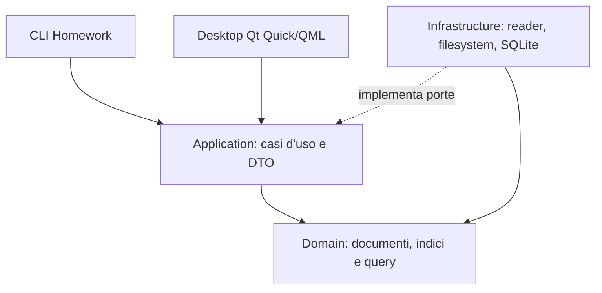

# Architettura, ownership e dominio

CLI e desktop Qt Quick usano lo stesso backend Python nello stesso processo, senza server o IPC. La CLI compone un indice volatile; il desktop usa `compose_v2_application`. [Stato ed evidenze](README.md#stato-implementato).

## Ownership e dipendenze

| Percorso | Responsabilità |
|---|---|
| `backend/src/local_document_search/domain/` | Documenti, analyzer, query, indici, vocabolari, ranking, highlighting e snapshot; solo standard library e dominio, nessun I/O |
| `backend/src/local_document_search/application/` | Casi d’uso, DTO, porte, job, sync, cancel e preferenze; nessun adapter concreto o Qt |
| `backend/src/local_document_search/infrastructure/` | Discovery, reader, SQLite e lock mediante le porte |
| `backend/src/local_document_search/interfaces/` | CLI e composizione backend |
| `frontend/src/local_document_search_desktop/` | Controller, modelli, QML, traduzioni e asset; usa API applicative, non posting o storage interni |
| `scripts/dev/`, `scripts/package/` | Avvio sviluppo, build, installer e pubblicazione |
| `experiments/` | Generatori, manifest, ground truth e runner funzionali/prestazionali |
| `docs/`, `docs/archive/v1/` | Specifiche correnti e pagina di accesso alla storia v1 in Git |

Le astrazioni rappresentano confini reali: niente `shared/` generico o porta per ogni classe. La CLI resta installabile senza Qt. Corpus scaricati/generati, testo estratto, snapshot, log, build, dist e risultati locali restano fuori Git; manifest e ground truth sono versionati.

## Modello e invarianti

Un file è un documento identificato da directory e percorso relativo: case e Unicode preservati, separatori serializzati come `/`, ordine lessicografico indipendente dalla locale. Niente deduplicazione per contenuto o hard link; basename uguali in cartelle diverse restano distinti. La radice assoluta è risolta dall’infrastruttura; alias non riconosciuti richiedono nuova selezione. Rename equivale a rimozione e aggiunta.

Il catalogo lega `DocumentId`, formato, nome, fingerprint (`size_bytes`, `mtime_ns`) e testo estratto, non copie dei binari originali. `DocumentId` è opaco per i chiamanti: preservato su invariati/modificati, mai riciclato nella vita dell’indice. L’allocatore persistente prenota prima del candidato, sopravvive a rollback, retention, rebuild, cambio directory e restart; può lasciare buchi. Solo una pulizia riuscita avvia una nuova vita; la CLI usa un contatore per sessione. Dati preesistenti privi di allocatore richiedono pulizia esplicita prima di nuovi job.

Il manifest ha una entry per percorso: INDEXED riferisce un unico documento coerente; EXCLUDED conserva fingerprint/formato/motivo senza ID o posting. INDEXED→EXCLUDED rimuove l’ID, EXCLUDED→INDEXED ne riceve uno nuovo. Errori reader interrompono il candidato, non diventano esclusioni.

Lo snapshot immutabile comprende manifest, catalogo, testo, due indici posizionali (`filename`, `content`) e una tupla ordinata del vocabolario per campo. Mappe copiate e in sola lettura, posizioni/clausole in tuple. Le posting riferiscono solo ID del catalogo e posizioni zero-based strettamente crescenti, indipendenti per campo; sostituzioni/rimozioni non lasciano occorrenze obsolete. Lo snapshot valida riferimenti, metadati e copertura dei token senza rianalizzare il testo; vocabolario e indice primario devono riferirsi agli stessi termini e versione. Nessuna query legge un draft. Schema e processing devono essere compatibili prima della ricerca.

Ogni campo deve soddisfare l’intera query AND/frasi; BOTH unisce i risultati dei due campi. Prefissi espliciti, filtri e ranking non alterano questo vincolo. Snippet e dettagli portano lo `snapshot_id` e usano il testo acquisito, senza rileggere i sorgenti o promettere coordinate/layout PDF. [Semantica](INDEXING_AND_ANALYSIS.md) e [contratti](INTERFACE_CONTRACTS.md).

Il desktop sposta il lavoro nei worker e scarta risposte obsolete rispetto a query, directory e snapshot. Lingua e tema sono preferenze persistenti separate dall’indice. Storage v2 in `%LOCALAPPDATA%/LocalDocumentSearch/Data`, v1 in `%LOCALAPPDATA%/LocalDocumentSearch`: nessuna migrazione automatica o pulizia incrociata. [Privacy e distribuzione](SECURITY_AND_PRIVACY.md).

## Snapshot e sincronizzazione

SQLite v2 conserva manifest per snapshot e versioni immutabili di testo/posting per documento; riusa gli invariati. Posting JSON compressi con zlib e validati, mai pickle o full-text SQL. In RAM vivono attivo, draft e letture acquisite; il precedente viene caricato su richiesta, senza spill generale. Risorse esaurite danno `ResourceFailure` quando intercettabili.

Il diff confronta solo path, size e `mtime_ns`: aggiunti letti/analizzati, modificati sostituiti in entrambi i campi, rimossi eliminati, invariati riusati senza rileggere contenuto (anche EXCLUDED). Nessuna differenza con versioni compatibili → NO_CHANGES, nessun nuovo snapshot. Durante ingestione si ricontrollano i metadati prima/dopo lettura/elaborazione: variazioni osservate falliscono il candidato e consentono retry. Modifiche con size/mtime invariati possono sfuggire; nessun hash sorgente o accesso ai sorgenti nelle query.

Un solo writer costruisce il draft privato; `save_candidate` → `validate_candidate` → `activate` condividono il confine transazionale senza commit intermedi. SQLite usa foreign keys, journal DELETE e synchronous FULL. Validazione dello staging e riferimento attivo precedono COMMIT; pubblicazione in RAM solo dopo. Errore/cancel prima del commit scarta il candidato, preservando l’attivo della stessa directory. Crash al commit lascia vecchio o nuovo completo; crash dopo commit prima della pubblicazione RAM recupera il nuovo persistito. Il commit non è interrompibile; dettagli del cancel nei [contratti](INTERFACE_CONTRACTS.md#job-stato-e-chiusura).

Retention conserva attivo e precedente della sola directory corrente, più versioni acquisite fino al rilascio. Rimozioni differite vengono ritentate al rilascio/riavvio; errori di pulizia sono diagnostiche riprovabili, non annullano un commit riuscito. `acquire(snapshot_id)` protegge la versione; `load_active()` non prenota retention. Versioni candidate, rimosse, incompatibili o di altra directory non sono consultabili; dettagli senza fallback alla versione corrente.

## Lifecycle persistente

Il lock OS esclusivo precede l’apertura dei database e dura per tutta la sessione; una seconda sessione riceve `StorageFailure`. `session.lock` può restare dopo un crash: non è un sentinel. La CLI volatile non acquisisce questo lock. Gli adapter diretti richiedono un proprietario esterno unico; per la concorrenza usare la composizione.

Startup recupera settings e snapshot compatibile, poi richiede sync asincrono; sorgente assente conserva ricerca e dati con avviso. Cambiare directory invalida nuove letture della precedente, mentre quelle già acquisite completano. Nessuna cache multi-directory: i vecchi dati sono rimossi quando liberi; tornando a una cartella occorre reindicizzare. Finché manca il primo snapshot della nuova directory, la ricerca è indisponibile.

`schema_version`/`processing_version` incompatibili o snapshot corrotti richiedono rebuild/recovery **espliciti** in v2, senza ricerca sui dati incompatibili né migrazione v1. Se il database selezionato non può essere aperto per incompatibilità, il rebuild usa un database candidato distinto; il catalogo di controllo lo seleziona solo dopo commit/validazione. Prima della selezione resta il riferimento precedente; orfani registrati sono ripuliti al riavvio, senza enumerare file estranei per eliminarli. Sync e rebuild su un database apribile pubblicano nel database corrente. Se manca la sorgente il rebuild fallisce preservando i dati.

Pulizia a job fermo: blocca nuove letture, attende quelle accettate e rimuove database dati registrati/sidecar, settings, preferenze e stato operativo; il contenitore di controllo vuoto è riutilizzabile. Non tocca sorgenti, dati v1 o file estranei. Fallimenti sono visibili e riprovabili, senza garanzia di cancellazione forense. Chiusura e progressi sono nei [contratti](INTERFACE_CONTRACTS.md#job-stato-e-chiusura).
