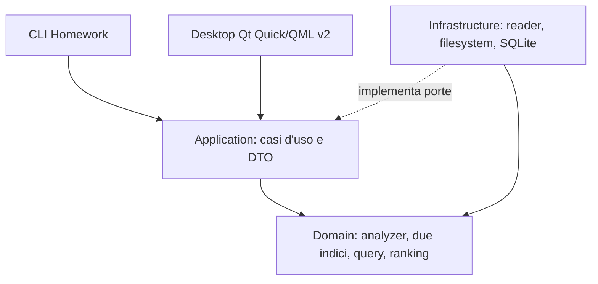

# Architettura v2 — Backend condiviso e desktop locale

**Stato:** confini di v1 implementati; estensioni v2 approvate ma non implementate. V2 modifica progressivamente gli stessi package, mantenendo le porte e gli invarianti compatibili come base di regressione. [Baseline](BASELINE.md), [ADR](adr/README.md).

Il dominio resta puro e senza I/O; application orchestra e definisce porte, senza adapter concreti o Qt. Infrastructure possiede sorgenti e storage. CLI e desktop hanno composition root dedicati sullo stesso backend. UI e backend restano nello stesso processo, senza server o IPC. L'[ownership](REPOSITORY_LAYOUT.md) definisce dove collocare il codice.

## Indicizzazione e consistenza

Una directory attiva, discovery ricorsiva senza link/junction, TXT/MD/PDF testuali; un file equivale a un documento. Manifest e diff usano percorso, dimensione e `mtime_ns`. Reader producono testo canonico oppure esclusione/errore distinti. Analyzer di nome e contenuto costruiscono due indici invertiti posizionali, più l'indice secondario ordinato dei rispettivi vocabolari v2.

Il draft è privato al single-writer. Candidato, manifest, catalogo, testo e indici vengono pubblicati come snapshot immutabile solo dopo commit atomico. Le ricerche già avviate conservano una versione acquisita; durante sync resta consultabile il precedente snapshot della stessa directory. Errori e cancel prima del commit non pubblicano il candidato. [Dettagli](SNAPSHOTS_AND_SYNC.md).

## Letture e presentazione

La query viene analizzata con gli stessi analyzer dell'indicizzazione. I due campi sono valutati separatamente; BOTH unisce solo risultati che soddisfano tutta la query in un campo. Il vocabolario ordinato serve a prefissi e suggerimenti, non rimpiazza le posting posizionali. Filtri e ranking producono un ordine deterministico; snippet e anteprima derivano dal testo persistito nella versione acquisita. Nessuna ricerca consulta i sorgenti. [Semantica](INDEXING_AND_ANALYSIS.md), [contratti](INTERFACE_CONTRACTS.md).

Il desktop Qt Quick consuma DTO applicativi, senza accesso diretto a SQLite o posting. Worker separano sync e letture dal thread UI. Risposte obsolete non sovrascrivono query, directory o selezione più recenti. Le preferenze di lingua/tema sono dati applicativi, separati dagli indici. La CLI mantiene la sua composizione volatile e i suoi output.

## Distribuzione

V2 usa storage per utente separato da v1 e un installer offline. Nessuna migrazione automatica o manipolazione del contenitore v1. Il confine v1/v2 e la strategia fisica v2 richiedono la decisione [V2-D04](OPEN_DECISIONS.md). L'installer e le licenze richiedono [V2-D07…D09](OPEN_DECISIONS.md). [Privacy e diritti](SECURITY_AND_PRIVACY.md).
