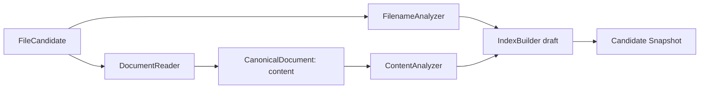

# Indexing Pipeline & Text Analysis

**Obiettivo:** separare lettura del formato, normalizzazione testuale e costruzione del positional inverted index.

## 1. Pipeline



I reader producono **testo puro**, non token. Gli analyzer conoscono il **campo**, non il tipo di file. Il builder riceve token e posizioni e aggiorna entrambi gli indici.

## 2. Discovery e lettura

| Formato | Trasformazione richiesta | Limiti |
|---|---|---|
| `.txt` | Decodifica in testo; nessuna struttura documentale | Encoding invalido → errore; eventuali encoding alternativi TBD |
| `.md` | Estrazione di testo visibile; **blocchi di codice esclusi** | Trattamento di link, immagini, tabelle, HTML inline e front matter TBD |
| `.pdf` | Estrazione del testo digitale presente | Nessun OCR; PDF senza testo esclusi; ordine colonne/tabelle imperfetto |

Un file canonico ha **un unico `content: str`**, privo di pagine, segmenti o offsets strutturali del formato. L'output dei reader non viene sottoposto a stemming o case folding: sono compiti degli analyzer.

## 3. Analyzer: regole definite e dettagli proposti

**Definito:** due analyzer distinti, uno per nome e uno per contenuto; indipendenza dal formato; stesso analyzer per indicizzazione e query; supporto a corpus multilingue; posizioni per phrase query.

**Baseline da confermare durante la specifica del tokenizer** (non considerarla vincolante finché non è testata):

- Unicode NFC, case folding, tokenizzazione Unicode per lettere/numeri/segni combinanti;
- mantenere gli accenti; **nessuno** stemming e **nessuna** rimozione stop words (evita complicazioni nelle phrase query multilingue);
- filename: delimitatori (`_`, `-`, `.`) e possibile separazione CamelCase / lettere-numeri;
- contenuto: punteggiatura come separatore e posizioni per ogni token;
- gestione di apostrofi, numeri, acronimi, emoji e testi CJK da definire precisamente;
- decisione se includere il suffisso `.txt`/`.md`/`.pdf` nel filename index ancora aperta.

La compatibilità tra tokenizzazione di nome e contenuto non è richiesta; **la compatibilità fra fase di indicizzazione e fase di ricerca per lo stesso campo sì**.

## 4. Postings e posizioni

```text
content_index:
  "roma" -> {doc42: [0, 7], doc51: [3]}
  "tre"  -> {doc42: [1, 8], doc51: [9]}
```

Query `"roma tre"`: doc42 corrisponde (0→1 o 7→8), doc51 no (3→9). Per una frase `t0,...,tk-1` esiste un match nel documento d se c'è una posizione p con `p+i` nella posting di `ti` per **ogni i**. I termini ripetuti devono usare occorrenze distinte; la semplice intersezione dei documenti non è sufficiente.

Per termini non quotati, l'AND opera sui **docID** di un singolo campo. Con `BOTH`, si esegue la query completa indipendentemente su filename e content e si uniscono i docID risultanti.

## 5. Aggiornamento dei documenti

- Nuovo: assegnare ID, generare posting nome + contenuto, aggiungere catalogo e manifest.
- Modificato (stesso path): rimuovere vecchie posting da **entrambi** i campi, poi aggiungere nuove posting e testo persistito coerenti.
- Eliminato: rimuovere posting, documento dal catalogo ed entry dal manifest nuovo.
- Invariato: riutilizzare la rappresentazione già indicizzata senza rileggere il contenuto.
- Escluso: registrare nel manifest, senza IndexedDocument né posting.

Queste operazioni modificano solo uno **SnapshotDraft**, mai lo snapshot attivo.

## 6. Perdita intenzionale d'informazione

Non conserva pagine PDF, sezioni Markdown o coordinate. Le phrase queries possono attraversare confini di pagina o paragrafo e possono produrre falsi match da artefatti di estrazione (es. colonne unite nell'ordine errato). È un limite accettato del modello semplificato.

Il testo estratto completo è persistito; eventuali snippet e highlighting potranno essere creati a posteriori. Offset token→testo e strategia di ranking/snippet restano da definire.

## 7. Test di specifica da scrivere

Unicode e case folding, accenti, CamelCase, apostrofi, termini ripetuti, frase assente con parole lontane, documenti con nomi identici in sotto-cartelle, PDF non testuali, Markdown con blocchi codice, file vuoti. Vedi [TEST_STRATEGY](TEST_STRATEGY.md).
