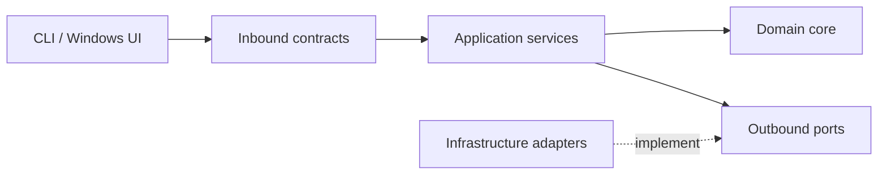

# Interface Contracts — Application API e porte infrastrutturali

**Stato:** contratti logici in-process. M1 implementa i DTO di ricerca e le quattro porte; M3 implementa `BuildIndex.execute(root_directory) -> BuildResult`, `SearchDocuments.execute(SearchRequest) -> SearchResponse`, discovery TXT, reader e repository volatile. M4 estende la stessa CLI a Markdown/PDF con discovery multiformato e dispatcher dei reader; firme delle porte e DTO invariati ([evidenze](M4_VERIFICATION.md)). Lifecycle, job, `GetDocument` e persistenza restano nelle milestone successive.

Le porte usano nomi Python snake_case: `discover`, `read`, `load_active`, `save_candidate`, `validate_candidate`, `activate`, `discard_candidate`; settings usa `load`, `save`, `clear`. `FileCandidate` contiene radice e `DocumentMetadata`; il reader restituisce `Extracted`, `Excluded` o `ExtractionFailed`. `Settings` contiene directory e ultimo controllo opzionali (`LastCheck`, con esito `SyncOutcome`). Sono tipi di scambio, senza persistenza o lifecycle implementati.

I DTO copiano le collezioni ricevute. `SearchRequest` rifiuta query vuote, campi non validi e paginazione non valida tramite `InvalidInput`; sintassi e clausole senza token sono validate dal parser/analyzer M2. I valori di dominio non validi sollevano `ValueError`; M3 traduce gli errori del parser in `InvalidInput` nel caso d'uso. `matched_fields` contiene solo FILENAME e/o CONTENT, mai BOTH. Il servizio operativo M3 usa il motore M2 senza accessi ai sorgenti durante la ricerca. [Verifica M3](M3_VERIFICATION.md).

## 1. Modello di dipendenza

Presentation → **Inbound use cases** → Application → Domain. Application definisce **Outbound ports**, Infrastructure li implementa. Il composition root assembla i componenti senza introdurre dipendenze infrastrutturali nel Domain.

## 2. Inbound (richieste della UI o CLI)

| Use case | Richiesta | Risposta | Regole |
|---|---|---|---|
| `InitializeApplication` | nessuna | `ApplicationState` | Recupera ultima directory e snapshot valido; se possibile avvia sync asincrono |
| `SelectDirectory` | `absolute_path` | `DirectorySelectionResult` | Valida, salva e avvia sync; rifiuta cambio cartella con job attivo |
| `RequestSynchronization` | `trigger` (startup/select/manual) | `JobRef` | Non lancia un secondo job; restituisce il job già attivo ove applicabile |
| `RunSynchronization` | trigger | `SyncResult` | Modalità bloccante, **stesso** algoritmo; destinata a CLI/test |
| `GetIndexStatus` | nessuna | `IndexStatus` | Directory, snapshot attivo, stato sync/ricerca, ultima diagnostica |
| `GetJobStatus` | `job_id` | `JobStatus` | Stato e progress aggiornati, anche con totali non ancora noti |
| `SearchDocuments` | `SearchRequest` | `SearchResponse` | Ricerca solo su snapshot attivo e stabile |
| `GetDocument` | `document_id`, `snapshot_id` | `DocumentDetails` | Testo della versione richiesta; SnapshotUnavailable se rimossa/incompatibile |
| `ClearLocalData` | nessuna | esito oppure errore | Rifiuta durante job; blocca nuove letture, attende quelle in corso, elimina dati applicativi e torna senza directory |

`SelectDirectory` e `InitializeApplication` non sono autorizzati a usare uno snapshot appartenente a **un'altra directory**. Se il primo indice di una nuova directory non è pronto, la ricerca non è disponibile.

### DTO minimi (schema logico)

| DTO | Campi significativi |
|---|---|
| `ApplicationState` | `active_directory?`, `active_snapshot_id?`, `search_available`, `job?`, `warning?` |
| `JobRef` | `job_id`, `status`, `reused` |
| `IndexStatus` | `active_directory?`, `active_snapshot_id?`, `last_sync_outcome?`, `job?`, `search_available` |
| `JobStatus` | `job_id`, `state`, `phase`, `files_total?`, `files_completed`, `bytes_total?`, `bytes_completed`, `current_file?`, `started_at`, `finished_at?`, `error?` |
| `SearchRequest` | `query`, `field` (default BOTH), `limit` (default 50), `offset` (default 0) |
| `SearchResponse` | `snapshot_id`, `results`, `total_matches` |
| `SearchResult` | `document_id`, `filename`, `relative_path`, `format`, `matched_fields` |
| `DocumentDetails` | `snapshot_id`, `document_id`, metadati, `extracted_text` |
| `SyncResult` | `snapshot_id?`, `changed`, `added`, `modified`, `removed`, `unchanged`, `excluded`, `failed`, `elapsed`, `processed_bytes` |

`?` indica un campo opzionale o **non ancora obbligatorio**. Sono contratti in-process, non endpoint HTTP/IPC. Limit positivo e offset non negativo, altrimenti InvalidInput. Ordinare per percorso relativo preservato prima di paginare.

### Paginazione e versione dei risultati

Ogni `SearchDocuments` acquisisce lo snapshot attivo all'inizio della richiesta; `SearchRequest` non seleziona una versione. `SearchResponse.snapshot_id` identifica la versione usata per risultati e totale.

Per una pagina successiva, la UI confronta lo `snapshot_id` restituito con quello della lista visualizzata: se coincide mantiene l'offset richiesto; se differisce scarta la risposta e ripete la stessa query e campo con `offset=0`, sostituendo lista e totale con la nuova prima pagina. La prima pagina accetta la versione acquisita dalla nuova richiesta, senza inseguire ulteriori commit.

Un cambio query, campo o directory rende obsolete le risposte precedenti, compreso un eventuale ritorno alla prima pagina ancora in corso. Un risultato senza corrispondenze è valido: `results=[]`, `total_matches=0`, con lo `snapshot_id` interrogato. Un offset oltre i risultati produce una pagina vuota mantenendo il totale effettivo; se cambia versione si applica comunque il ritorno alla prima pagina.

### Query semantics

- Modalità predefinita `BOTH`: `match_fully(filename, q) OR match_fully(content, q)`.
- Clausole termini/frasi combinate in AND; ogni frase richiede posizioni consecutive. L'intera lista deve corrispondere in **un solo campo**.
- Il parser converte la stringa utente in una query strutturata; gli analyzer usati sui termini della query devono corrispondere a quelli di indicizzazione.
- CLI: prefisso iniziale non quotato `nome`, `contenuto`, `entrambi`, separato da whitespace; assente → BOTH. L'adapter CLI rimuove il prefisso; la UI usa un controllo campo separato.
- Virgolette doppie delimitano frasi combinabili con termini: `contenuto machine "deep learning"`. Nessun operatore OR/NOT o escape dedicato nella v1; quei nomi nel testo sono termini normali.
- Input vuoto, clausola senza token o virgolette sbilanciate → InvalidInput. Non ignorare clausole vuote. In BOTH analizzare separatamente i campi e rifiutare clausole senza token.
- Parser restituisce testo/clausole, non token condivisi fra analyzer. `reused=true` distingue il job già in corso da uno appena avviato.

## 3. Outbound ports (Application → Infrastructure)

### `FileDiscoveryPort`

**In:** directory assoluta valida.  
**Out:** sequenza ordinata di `FileCandidate(relative_path, format, size_bytes, mtime_ns, ...)` oppure errore esplicito di scansione.

**Garantisce:** visita ricorsiva, soli suffissi `.txt`, `.md`, `.pdf`, nessun attraversamento di symlink/junction di directory, nessuna indicizzazione di symlink a file. Path preservati secondo [Dominio](DOMAIN_MODEL.md), nessun casefold dei percorsi. La CLI M4 usa `DocumentFileDiscovery` per tutti i formati; `TextFileDiscovery` conserva il filtro TXT per gli utilizzatori esistenti.

**Non fa:** diff, lettura del contenuto, decisione su validità di uno snapshot.

### `DocumentReaderPort`

**In:** `FileCandidate`.  
**Out:** variante esplicita fra `Extracted(CanonicalDocument)`, `Excluded(reason)` ed `ExtractionFailed(reason)`.

- TXT/Markdown con encoding invalido → errore, no commit.
- Markdown: blocchi di codice esclusi dal testo recuperato.
- PDF senza testo → esclusione intenzionale; PDF illeggibile → errore.
- Nessun Reader assegna `DocumentId`, costruisce posting o decide la posizione nell'indice.

### `SnapshotRepositoryPort`

**Operazioni logiche:** `LoadActive`, `SaveCandidate`, `ValidateCandidate`, `Activate`, `DiscardCandidate`.

**Contratto di consistenza:** `Activate` cambia il riferimento attivo soltanto quando candidato e manifest sono completi e validi. `LoadActive` non restituisce mai una versione parziale. Candidato fallito/non completato non sostituisce l'ultimo attivo.

Adapter SQLite: SaveCandidate, ValidateCandidate e Activate condividono una transazione, senza commit intermedi. Pubblicazione in RAM dopo commit. Retention e recovery in [Snapshot](SNAPSHOTS_AND_SYNC.md). Repository responsabile anche di rilascio/pulizia delle versioni non in uso e cancellazione dei dati di sua proprietà.

### `SettingsRepositoryPort`

**Operazioni logiche:** leggere, salvare e cancellare ultima directory e stato operativo di ultimo controllo/esito. Non persiste conteggi derivabili dal manifest né documenti/indici. ClearLocalData coordina pulizia degli adapter, inclusi log/temporanei; nessun accesso UI al filesystem.

## 4. Collaborazione interna (senza porta esterna obbligatoria)

- `FilenameAnalyzer`, `ContentAnalyzer`: testo → sequenza deterministica di token con posizioni.
- `QueryParser`: input testuale → query interpretata.
- `IndexBuilder`: add/replace/remove documento su un **draft**; non esegue I/O.
- `QueryEvaluator`: query normalizzata + snapshot → corrispondenze.
- `IndexSynchronizer`: usa discovery, readers, domain e repository, pubblicando eventi di progresso.
- `IndexingJobManager`: serializza le richieste e coordina esecuzione bloccante/asincrona. **Non implementa** gli algoritmi del motore.

## 5. Stati ed errori

`JobStatus.state`: PENDING, RUNNING, COMPLETED, FAILED. Le fasi di RUNNING: SCANNING, EXTRACTING, ANALYZING, BUILDING, COMMITTING (implementazione può fondere fasi purché il contratto rimanga interpretabile).

Categorie di errore:

- `InvalidInput`: query/parametri/path non validi; nessun job utile avviato.
- `ExtractionFailure`: reader inatteso/encoding; no commit.
- `StorageFailure`: scrittura/lettura/validazione/attivazione; mantenere precedente.
- `ResourceFailure`: memoria o spazio insufficiente; no commit.
- `SourceUnavailable`: directory salvata non trovata; segnalare, non cancellare automaticamente lo snapshot.
- `SnapshotUnavailable`: richiesta di documento di una versione già eliminata/non disponibile.

**Non introdurre ancora** eccezioni Python specifiche a ogni singola riga della tabella.

## 6. Compatibilità tra sessioni

Versioni `schema_version` e `processing_version` viaggiano nello snapshot. Una versione incompatibile non viene assunta valida solo perché i metadati dei file sono invariati. Incompatibilità → rebuild automatico, nessuna ricerca sui dati incompatibili né migrazione. Vecchi dati conservati fino al successo; sorgente assente → errore esplicito. Vedi [Snapshot](SNAPSHOTS_AND_SYNC.md).

## 7. Superficie operativa M3

`compose_cli(directory)` risolve e valida la radice in infrastructure e restituisce `CliApplication(root_directory, build, search)`. Ogni sessione usa una sola directory, un repository in memoria e un build iniziale bloccante. Il cablaggio M1 `compose_application` resta disponibile per dipendenze esplicite; non implementa lifecycle o settings operativi.

`BuildIndex.execute(root_directory)` richiede la radice assoluta validata dall'adapter e costruisce un indice completo, senza diff. `BuildResult` immutabile contiene `snapshot_id`, `discovered`, `indexed`, `excluded`, `processed_bytes`, `elapsed` (secondi monotoni). Gli errori sono eccezioni, non risultati di successo con conteggi parziali. Gli ID progressivi sono allocati dall'application; un fallimento può lasciare intervalli inutilizzati. Il riuso multi-directory, la concorrenza e `SyncResult` appartengono alle milestone successive.

La sequenza di pubblicazione è save → validate → activate; un errore scarta il candidato e conserva l'attivo. Il repository volatile non scrive su disco e richiede un candidato validato prima di attivarlo. Il single-writer è assicurato dalla sessione sincrona, non da un JobManager o lock tra processi. Le varianti `Excluded` ed `ExtractionFailed` restano distinte; il reader TXT produce soltanto `Extracted` o `ExtractionFailed`.

Gli errori operativi M3 sono `SourceUnavailable`, `ExtractionFailure`, `StorageFailure`, `ResourceFailure`, `SnapshotUnavailable`, derivati da `ApplicationError`; `InvalidInput` rimane un `ValueError`. La ricerca senza indice alza `SnapshotUnavailable`. La scansione non salta silenziosamente directory illeggibili. La radice viene controllata prima della risoluzione, inclusi componenti antenati link/reparse point.

CLI: `local-document-search DIRECTORY`, percorso relativo o assoluto. I prefissi sono esattamente `nome`, `contenuto`, `entrambi` minuscoli, iniziali e non quotati; un prefisso senza query è invalido. Il testo `"nome"` resta una query ordinaria. Un errore di query mantiene aperta la sessione; un errore di build impedisce la ricerca. La CLI mostra tutti i risultati recuperando pagine da 50, con percorso relativo e campi corrispondenti.

Codici d'uscita: 0 su EOF normale o help; 1 errore operativo (inclusa directory assente); 2 argomenti non validi (incluso percorso non-directory o link); 130 su Ctrl+C. La sessione non riserva parole come `exit`: si esce con EOF (Windows: Ctrl+Z poi Invio; Unix: Ctrl+D) o Ctrl+C. Ctrl+C non attiva candidati incompleti; se arriva dopo l'attivazione lo snapshot è già completo.
