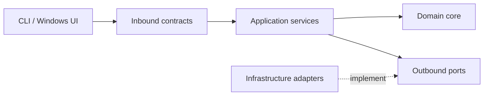

# Interface Contracts — Application API e porte infrastrutturali

**Stato:** contratti **logici**, non firme Python/API HTTP. Nomi dei metodi e tipi concreti potranno essere affinati in implementazione senza cambiare le responsabilità.

## 1. Modello di dipendenza

Presentation → **Inbound use cases** → Application → Domain. Application definisce **Outbound ports**, Infrastructure li implementa. Il composition root assembla i componenti senza introdurre dipendenze infrastrutturali nel Domain.

## 2. Inbound (richieste della UI o CLI)

| Use case | Richiesta | Risposta | Regole |
|---|---|---|---|
| `InitializeApplication` | nessuna | `ApplicationState` | Recupera ultima directory e snapshot valido; se possibile avvia sync asincrono |
| `SelectDirectory` | `absolute_path` | `DirectorySelectionResult` | Valida, salva e avvia sync; rifiuta cambio cartella con job attivo |
| `RequestSynchronization` | `trigger` (startup/select/manual) | `JobRef` | Non lancia un secondo job; restituisce il job già attivo ove applicabile |
| `RunSynchronization` | trigger | `SyncResult` | Modalità bloccante, **stesso** algoritmo; destinata a CLI/test |
| `GetIndexStatus` | nessuna | `IndexStatus` | Directory, snapshot attivo, stato sync/ricerca, ultima diagnostica |
| `GetJobStatus` | `job_id` | `JobStatus` | Stato e progress aggiornati, anche con totali non ancora noti |
| `SearchDocuments` | `SearchRequest` | `SearchResponse` | Ricerca solo su snapshot attivo e stabile |
| `GetDocument` | `document_id`, `snapshot_id` | `DocumentDetails` | Testo persistito; gestire versione eventualmente non più disponibile |

`SelectDirectory` e `InitializeApplication` non sono autorizzati a usare uno snapshot appartenente a **un'altra directory**. Se il primo indice di una nuova directory non è pronto, la ricerca non è disponibile.

### DTO minimi (schema logico)

| DTO | Campi significativi |
|---|---|
| `ApplicationState` | `active_directory?`, `active_snapshot_id?`, `search_available`, `job?`, `warning?` |
| `JobRef` | `job_id`, `status` |
| `IndexStatus` | `active_directory?`, `active_snapshot_id?`, `last_sync_outcome?`, `job?`, `search_available` |
| `JobStatus` | `job_id`, `state`, `phase`, `files_total?`, `files_completed`, `bytes_total?`, `bytes_completed`, `current_file?`, `started_at`, `finished_at?`, `error?` |
| `SearchRequest` | `query`, `field`, `limit?`, `offset?` |
| `SearchResponse` | `snapshot_id`, `results`, `total_matches?` |
| `SearchResult` | `document_id`, `filename`, `relative_path`, `format`, `matched_fields`; `score?` futuro |
| `DocumentDetails` | `snapshot_id`, `document_id`, metadati, `extracted_text` |
| `SyncResult` | `snapshot_id?`, `changed`, `added`, `modified`, `removed`, `unchanged`, `excluded`, `failed`, `elapsed`, `processed_bytes` |

`?` indica un campo opzionale o **non ancora obbligatorio**. Lo schema di trasporto (JSON IPC, HTTP, chiamate in-process) non è definito: non trattare i nomi sopra come endpoint.

### Query semantics

- Modalità predefinita `BOTH`: `match_fully(filename, q) OR match_fully(content, q)`.
- Termini normali: AND, ordine non rilevante. Phrase queries: posizione consecutiva in **un solo campo**.
- Il parser converte la stringa utente in una query strutturata; gli analyzer usati sui termini della query devono corrispondere a quelli di indicizzazione.
- La sintassi finale dei filtri UI e degli operatori testuali sarà definita prima di implementare il parser. La CLI per l'homework dovrà accettare `nome`/`contenuto` e le virgolette.

## 3. Outbound ports (Application → Infrastructure)

### `FileDiscoveryPort`

**In:** directory assoluta valida.  
**Out:** sequenza ordinata di `FileCandidate(relative_path, format, size_bytes, mtime_ns, ...)` oppure errore esplicito di scansione.

**Garantisce:** visita ricorsiva, soli suffissi `.txt`, `.md`, `.pdf`, nessun attraversamento di symlink/junction di directory, nessuna indicizzazione di symlink a file. La politica esatta di case-insensitivity sui path Windows è da definire.

**Non fa:** diff, lettura del contenuto, decisione su validità di uno snapshot.

### `DocumentReaderPort`

**In:** `FileCandidate`.  
**Out:** variante esplicita fra `Extracted(CanonicalDocument)`, `Excluded(reason)` ed `ExtractionFailed(reason)`.

- TXT/Markdown con encoding invalido → errore, no commit.
- Markdown: blocchi di codice esclusi dal testo recuperato.
- PDF senza testo → esclusione intenzionale; PDF illeggibile → errore.
- Nessun Reader assegna `DocumentId`, costruisce posting o decide la posizione nell'indice.

### `SnapshotRepositoryPort`

**Operazioni logiche:** `LoadActive`, `SaveCandidate`, `ValidateCandidate`, `Activate`, `DiscardCandidate`.

**Contratto di consistenza:** `Activate` cambia il riferimento attivo soltanto quando candidato e manifest sono completi e validi. `LoadActive` non restituisce mai una versione parziale. Candidato fallito/non completato non sostituisce l'ultimo attivo.

Non prescriviamo **ancora** formato file, database, strategia di journaling, retention o atomic switch fisico.

### `SettingsRepositoryPort`

**Operazioni logiche:** leggere e salvare l'ultima directory scelta. Non persiste conteggi derivabili dal manifest, né documenti/indici.

## 4. Collaborazione interna (senza porta esterna obbligatoria)

- `FilenameAnalyzer`, `ContentAnalyzer`: testo → sequenza deterministica di token con posizioni.
- `QueryParser`: input testuale → query interpretata.
- `IndexBuilder`: add/replace/remove documento su un **draft**; non esegue I/O.
- `QueryEvaluator`: query normalizzata + snapshot → corrispondenze.
- `IndexSynchronizer`: usa discovery, readers, domain e repository, pubblicando eventi di progresso.
- `IndexingJobManager`: serializza le richieste e coordina esecuzione bloccante/asincrona. **Non implementa** gli algoritmi del motore.

## 5. Stati ed errori

`JobStatus.state`: PENDING, RUNNING, COMPLETED, FAILED. Le fasi di RUNNING: SCANNING, EXTRACTING, ANALYZING, BUILDING, COMMITTING (implementazione può fondere fasi purché il contratto rimanga interpretabile).

Categorie di errore:

- `InvalidInput`: query/parametri/path non validi; nessun job utile avviato.
- `ExtractionFailure`: reader inatteso/encoding; no commit.
- `StorageFailure`: scrittura/lettura/validazione/attivazione; mantenere precedente.
- `ResourceFailure`: memoria o spazio insufficiente; no commit.
- `SourceUnavailable`: directory salvata non trovata; segnalare, non cancellare automaticamente lo snapshot.
- `SnapshotUnavailable`: richiesta di documento di una versione già eliminata/non disponibile.

**Non introdurre ancora** eccezioni Python specifiche a ogni singola riga della tabella.

## 6. Compatibilità tra sessioni

Versioni `schema_version` e `processing_version` viaggiano nello snapshot. Una versione incompatibile non viene assunta valida solo perché i metadati dei file sono invariati. Politica esatta di migrazione/ricostruzione: [OPEN_DECISIONS](OPEN_DECISIONS.md).
