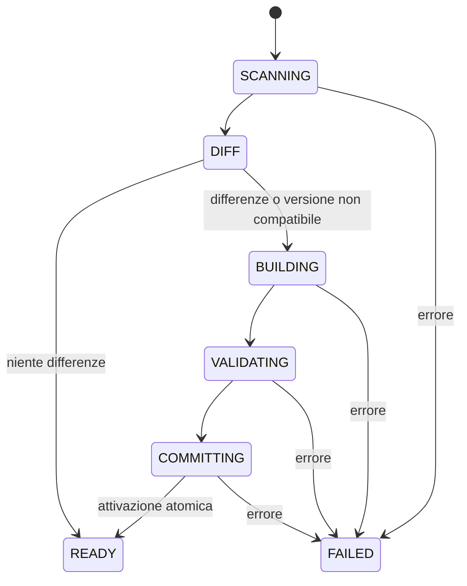

# Snapshots & Incremental Synchronization

**Stato:** semantica approvata; rappresentazione fisica e ottimizzazione dello storage TBD.

## 1. Definizioni

- **Active Snapshot:** indice completo, persistito, immutabile e interrogabile.
- **Building Snapshot:** candidato privato del job; non è visibile alla ricerca.
- **File Manifest:** elenco sorgenti elaborate con percorso relativo, `size_bytes`, `mtime_ns`, formato ed esito.
- **Sync:** osservazione puntuale della directory + confronto al manifest + eventuale nuovo snapshot.

Lo snapshot **non** è una copia dei file binari originali. Contiene gli indici, il catalogo, i metadati e il **testo estratto** dei documenti indicizzati.

## 2. Trigger

1. Selezione di nuova directory → primo snapshot/nuova sorgente.
2. Avvio app con directory salvata → carica snapshot precedente, effettua scansione e sync automatico.
3. Pulsante Sync → controllo/sync manuale.

Non esiste un watcher continuo: i cambiamenti successivi possono lasciare risultati obsoleti fino al prossimo trigger.

## 3. Algoritmo di diff (astratto)

Per ogni percorso relativo del filesystem e del manifest:

| Condizione | Categoria | Azione |
|---|---|---|
| Nuovo percorso | ADDED | Reader + analyzer + nuova entry/posting |
| Stesso path, fingerprint diverso | MODIFIED | Reader + analyzer; sostituire catalogo/posting |
| Path esistente solo nel manifest | REMOVED | Eliminare record e posting |
| Stesso path e fingerprint | UNCHANGED | Riutilizzare record e posting, senza leggere contenuto |

**Fingerprint = (`size_bytes`, `mtime_ns`).** Nessun hash, nessuna comparazione dei byte: è una decisione di prodotto. Se il contenuto cambia senza modificare entrambi i metadati, la differenza non viene rilevata.

Un rename è REMOVED + ADDED. Gli ID dei file modificati sullo stesso percorso possono essere preservati; lo schema concreto di allocazione è da definire.

Se nessuna differenza e nessuna incompatibilità di versione viene rilevata → **non creare un nuovo snapshot**.

## 4. Costruzione e commit

Il commit segue il protocollo logico:

1. Comporre il candidato con dati invariati e modifiche.
2. Verificare che manifest, catalogo, testo e posting soddisfino gli invarianti.
3. Salvare completamente il candidato (durability secondo la tecnologia da definire).
4. **Attivare** con un'operazione atomica di aggiornamento del riferimento attivo.
5. Solo dopo il successo dichiarare COMPLETED e mostrare il check.

Se il job fallisce, il precedente snapshot della **stessa directory** rimane attivo. I file temporanei del candidato saranno recuperati/scartati da un protocollo di recovery ancora da definire.

## 5. Ricerca e concorrenza

Un singolo scrittore, molte letture possibili sullo snapshot attivo. Una ricerca inizia su versione N e continua su N anche se N+1 diventa attivo. Non deve interrogare il candidato né mescolare le due versioni.

`SearchResponse` include uno `snapshot_id`. `GetDocument` riceve tale ID per recuperare il testo della versione corretta. Il periodo di mantenimento delle versioni precedenti e il caso di uno snapshot già rimosso sono ancora da decidere.

**Nuova directory:** non servire risultati della directory precedente; la ricerca è indisponibile finché manca uno snapshot valido della nuova.

**Sorgente indisponibile all'avvio:** non eliminare snapshot o directory salvata automaticamente; segnalare impossibilità di sincronizzare. La ricerca sullo snapshot locale precedente può essere consentita mostrando lo stato obsoleto se resta la stessa directory.

## 6. Progresso

- SCANNING: totale byte non ancora noto → stato indeterminato.
- EXTRACT/ANALYZE/BUILD: `processed_bytes / total_bytes` calcolato sulle dimensioni dei file **nuovi/modificati completati**, non su letture byte reali continue. È un'approssimazione, non ETA.
- REMOVED-only o solo COMMIT: barra indeterminata o fase esplicita, evitando divisione per zero.
- **100% e check** soltanto dopo commit/attivazione (oppure esito NO_CHANGES riuscito).

Il progresso è gestito dal JobManager; il frontend decide come visualizzarlo.

## 7. Esclusioni ed errori

PDF senza testo: entry EXCLUDED, fingerprint salvato per evitare tentativi inutili se invariato. Encoding invalido, file illeggibile non previsto, errore di storage: FAILED, **nessun commit parziale**. Symlink/junction ignorati in discovery, non persistiti come esclusioni.

## 8. Questioni ancora aperte

Serializzazione, struttura fisica snapshot, staging/atomic switch, fsync e recovery, gestione spazio disco/garbage collection, strategia di riuso delle posting invarianti, caching, grandi documenti. Vedi [OPEN_DECISIONS](OPEN_DECISIONS.md).
