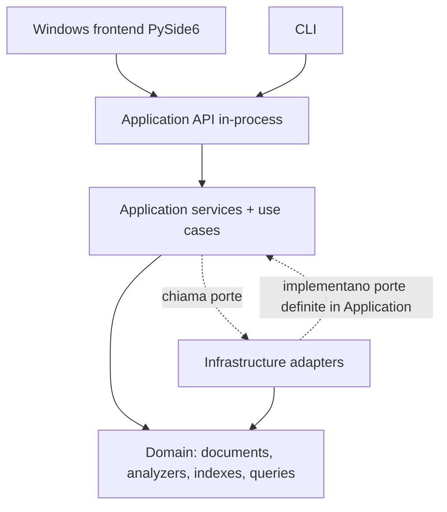

> Archivio v1 — fotografia documentale del 7 novembre 2026. Stati e risultati sono storici; non descrivono la v2. [Documentazione corrente](../../README.md).

# Architecture — Modular Monolith / Ports & Adapters

**Stato:** backend M1–M7 e desktop M8 implementati e verificati localmente; runtime concorrente e lock operativi. Distribuzione standalone ancora M9; [evidenze M8](M8_VERIFICATION.md).

## 1. Principi

1. Domain: identità documentale, manifest, indici, analyzer e regole di matching **senza I/O**.
2. Application: orchestration dei casi d'uso, sincronizzazione, sessione e job; definisce le porte di cui ha bisogno.
3. Infrastructure: filesystem, reader, persistenza snapshot e settings, implementando le porte.
4. Presentation: CLI e desktop Windows PySide6 tramite gli stessi contratti applicativi.
5. Un solo processo/job scrittore e un solo snapshot attivo per la directory corrente.

## 2. Dipendenze (dal codice)



Le frecce tratteggiate descrivono contratti/runtime. Il Domain **non importa** Application o Infrastructure; gli adapter concreti **dipendono** dalle astrazioni interne.

PySide6 Qt Widgets e backend nello stesso processo mediante contratti applicativi; nessun HTTP o IPC. CLI e UI hanno composition root dedicati che assemblano gli stessi servizi.

## 3. Flusso di indicizzazione


I file invariati possono riutilizzare informazioni dello snapshot precedente; i documenti rimossi devono sparire sia dal catalogo sia dai due indici. Riuso logico degli invariati, senza rilettura; serializzazione completa in SQLite, indici/draft in RAM.

## 4. Flusso della ricerca

`SearchRequest` → `QueryParser` → analisi coerente con il campo → `QueryEvaluator` → snapshot attivo immutabile → `SearchResponse`. La ricerca non legge direttamente dal filesystem e non controlla se i documenti originali esistano ancora. `GetDocument` può usare il testo persistito.

Ogni ricerca si lega allo snapshot acquisito all'inizio. Il risultato deve comunicare lo `snapshot_id` per evitare ambiguità con gli aggiornamenti concorrenti.

## 5. Aggregato persistente

```text
IndexSnapshot (immutable once active)
  snapshot_id
  root_directory
  schema_version
  processing_version
  created_at
  IndexManifest        # sorgenti e fingerprint, incluse esclusioni
  DocumentCatalog      # metadati + testo estratto dei documenti indicizzati
  FilenameIndex        # term -> docID -> sorted positions
  ContentIndex         # term -> docID -> sorted positions
```

L'`IndexSnapshot` è un **aggregate boundary logico**, non implica un singolo file o un'unica classe monolitica. I draft possono essere modificati solo durante il build; dopo il commit, nessuna parte della versione pubblicata viene alterata.

## 6. Runtime e concorrenza

- `InitializeApplication` recupera directory e snapshot, poi richiede un job di sincronizzazione se una directory è configurata.
- `SelectDirectory` blocca la selezione se un job è attivo e avvia il sync per la nuova sorgente.
- `IndexingJobManager` gestisce al massimo un job attivo; esecuzione asincrona per Windows, bloccante opzionale per CLI/test.
- Il frontend riceve status/progress DTO, mai oggetti interni di posting.
- Il nuovo snapshot è **candidato** fino alla persist/validate/activate. Gli errori lasciano in uso l'ultimo snapshot valido della stessa directory.
- Se viene scelta una directory diversa, non si mostrano risultati della directory precedente come se fossero della nuova.

## 7. Installazione e distribuzione

Il backend è un package Python con dominio indipendente dal sistema operativo. `frontend/` ospita il pacchetto separato PySide6 Qt Widgets, con dipendenza dal backend e launcher proprio. Il worker di coordinamento desktop esegue composizione e lifecycle, mentre i worker M7 eseguono sync e letture. Il timer Qt consuma solo Future concluse e non accumula polling. Target Windows 11 x64: ZIP portabile pyside6-deploy standalone, senza Python preinstallato. Versioni/configurazione riproducibili e verifica su ambiente pulito in M9.

## 8. Confini intenzionalmente esclusi

Nessuna architettura a microservizi; niente OCR o infrastrutture cloud; nessun framework di eventi general-purpose; niente interfaccia astratta per ogni singolo value object. Aggiungere porte solo per confini reali (I/O, testabilità e trasporto).

## 9. Documenti collegati

[DOMAIN_MODEL](DOMAIN_MODEL.md) · [INTERFACE_CONTRACTS](INTERFACE_CONTRACTS.md) · [SNAPSHOTS_AND_SYNC](SNAPSHOTS_AND_SYNC.md) · [REPOSITORY_LAYOUT](REPOSITORY_LAYOUT.md)

## 10. Runtime v1 e primo incremento

Un worker sync e un worker separato per ricerca/dettagli; execute rimane bloccante, submit restituisce Future.
La UI M8 riceve DTO e Future dai casi d'uso; nessun callback grafico nel backend.
Application non importa Qt; dominio non conosce thread, SQLite o reader.
Lock OS esclusivo per tutta la sessione persistente; seconda istanza rifiutata prima di aprire i database.
La CLI Homework usa soltanto memoria e non acquisisce il lock.
Chiusura attende job e letture; arresto forzato gestito dal recovery.
CLI M3 usa repository in memoria e build bloccante; M5/M6 introducono persistenza e diff
senza duplicare il motore né richiedere funzionalità future per la consegna.

## Stato distribuzione (2026-11-07)

Il packaging standalone è implementato; il nuovo ZIP e il collaudo locale finale sono in corso. La prova Windows pulito/account standard distinto è rinviata per decisione dell'utente e non è dimostrata dalle prove locali. L'allocatore documentale durevole è esterno agli snapshot; la CLI Homework continua a usare storage volatile senza lock di sessione persistente.
