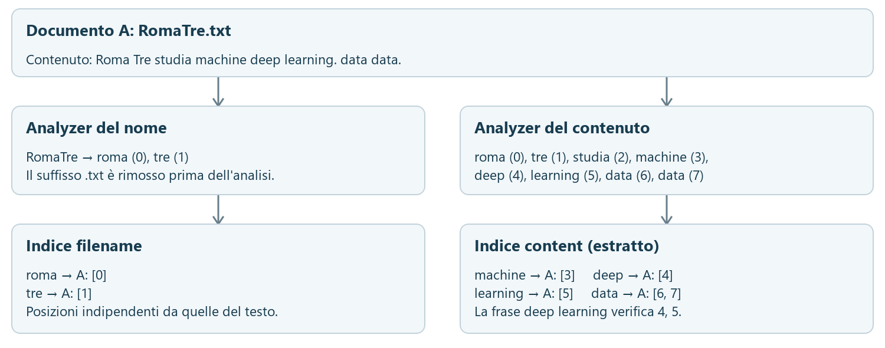
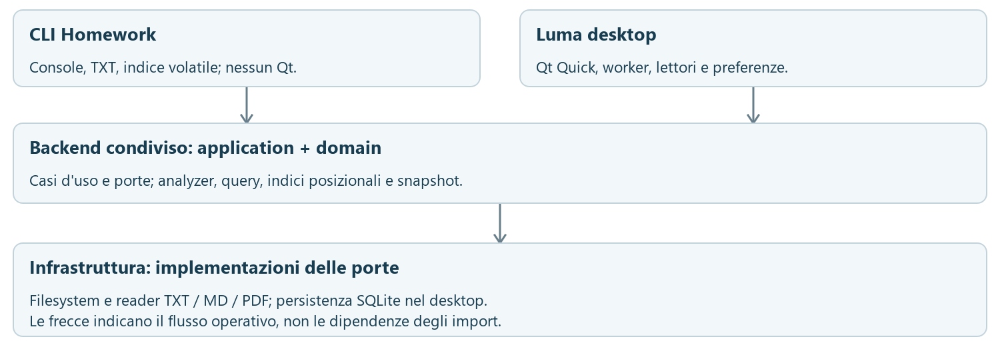
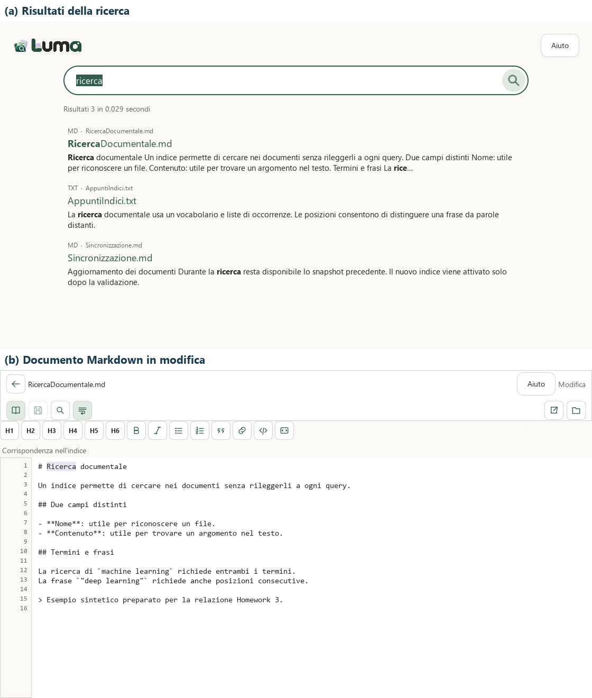

# 1. Obiettivo: cercare nei documenti, spiegare i risultati

Un documento può essere riconosciuto dal nome oppure dal contenuto. Un file chiamato `MachineLearning.txt` può parlare di modelli statistici senza contenere le parole del titolo. Local Document Search mantiene distinti i due campi e rende esplicito il significato della ricerca.

Il punto di partenza è l'Homework 3 di Ingegneria dei Dati: indicizzare i TXT di una directory, interrogare nome e contenuto dalla console e verificare il comportamento con circa dieci query. Il progetto è consultabile nel [repository GitHub Local Document Search](https://github.com/Forest904/local-document-search), con codice, test, decisioni architetturali e istruzioni di esecuzione.

**La consegna didattica è realizzata da una CLI autonoma.** Luma è l'evoluzione desktop dello stesso backend: aggiunge formati, persistenza e strumenti di lettura senza sostituire la prova richiesta dal corso. Questa relazione presenta prima il nucleo verificabile, poi le capacità costruite attorno a esso.

## Requisiti ed estensioni: due livelli riconoscibili

| Richiesta dell'homework | Realizzazione nel progetto |
|:--|:--|
| Indicizzare file TXT di una directory | Discovery ricorsiva e reader UTF-8; un file corrisponde a un documento |
| Due campi e analyzer motivati | Indici posizionali separati per nome e contenuto; regole illustrate nella sezione 2 |
| Query dalla console, anche per frasi | CLI con selezione del campo, AND e virgolette; risultati ordinati per percorso |
| Circa dieci prove e misure di indicizzazione | Otto TXT sintetici, dieci query e due regressioni; risultati nella sezione 4 |
| Relazione e URL del repository | Questo documento, sorgente Markdown e runner riproducibile |

Il perimetro aggiuntivo comprende PDF testuali e Markdown, riapertura dell'indice, sincronizzazione incrementale, ricerca avanzata e applicazione Windows installabile offline. La distinzione non riguarda soltanto il numero di funzioni: il passaggio a un'applicazione persistente richiede di gestire aggiornamenti, errori e versioni dei dati senza compromettere i risultati già disponibili.

Lo stato è aggiornato al **12 novembre 2026**: **0.2.1 pubblicata**, **0.2.2 candidato locale**. Implementazione, test e collaudo del pacchetto sono evidenze distinte.

\newpage

# 2. Dal file ai termini: gli analyzer

Un *analyzer* trasforma una stringa in una sequenza di token, cioè unità ricercabili, ciascuna associata alla propria posizione. Applicare regole coerenti al documento e alla query è essenziale: se la stessa parola venisse normalizzata diversamente nei due momenti, potrebbe non essere trovata.

## Un documento, due rappresentazioni

La scansione attraversa la directory e le sottocartelle, senza seguire symlink o junction. Ogni file è un documento; il percorso relativo lo distingue anche quando due sottocartelle contengono nomi uguali. Il nome e il testo alimentano due indici separati, non un'unica sequenza concatenata.

Il reader TXT decodifica UTF-8 in modo rigoroso e rimuove l'eventuale BOM iniziale, un marcatore di codifica. Un file vuoto rimane ricercabile attraverso il nome. L'assenza di contenuto e un errore di decodifica hanno dunque significati diversi: la prima è una condizione valida, il secondo impedisce di dichiarare completo un candidato di indicizzazione.

## Analizzare il nome

Prima dell'analisi si rimuove soltanto il suffisso finale supportato. Nei nomi sono frequenti parole concatenate e identificatori numerici: `RomaTre.txt` deve poter essere cercato con `roma` o `tre`, mentre `Unicode2026.TXT` contiene due componenti utili, `unicode` e `2026`.

L'analyzer introduce quindi separazioni nei confini CamelCase e nei passaggi fra lettere e cifre. Non interpreta il nome come una frase in linguaggio naturale: rende accessibili le componenti che una convenzione di denominazione ha compattato.

## Analizzare il contenuto

Nel testo non si aggiungono i confini CamelCase o lettera-cifra. Un identificatore scritto come parola unica conserva questa forma. Entrambi gli analyzer normalizzano Unicode in NFC, applicano *casefold* per il confronto senza distinzione di maiuscole e normalizzano nuovamente in NFC. Punteggiatura, apostrofi e underscore separano i token; gli accenti restano significativi.

| Stringa e campo | Token prodotti | Conseguenza |
|:--|:--|:--|
| Nome `RomaTre.txt` | `roma`, `tre` | Il nome compatto è interrogabile per componenti |
| Contenuto `RomaTre` | `romatre` | Il testo conserva la parola unica |
| Nome `Unicode2026.TXT` | `unicode`, `2026` | Estensione ignorata, numero ricercabile |
| Contenuto `L'acqua e il caffè.` | `l`, `acqua`, `e`, `il`, `caffè` | Apostrofo separatore; accento preservato |

## Perché non stemming e stop word

Lo *stemming* ridurrebbe parole diverse a una radice; eliminare le *stop word* scarterebbe termini frequenti come articoli e preposizioni. Il progetto non applica queste trasformazioni: evita dipendenze dalla lingua e conserva tutte le posizioni per le frasi. La scelta rende prevedibile la corrispondenza, al prezzo di non unificare automaticamente varianti morfologiche o accentate. `caffè` e `caffe` rimangono distinti; l'eventuale proposta ortografica del desktop è un'operazione successiva e separata.

\newpage

# 3. Due indici posizionali: termini, AND e frasi

Un indice invertito associa ciascun termine ai documenti in cui compare. Qui ogni occorrenza conserva anche le posizioni: `termine → documento → posizioni`. La lista delle occorrenze è detta *posting list*. Il motore realizza queste strutture internamente, senza delegare la ricerca a un motore IR esterno o al full-text di SQLite.

{width=100%}

## Dalla presenza all'adiacenza

Nel documento A, `machine` è in posizione 3 e `learning` in posizione 5. La query `contenuto machine learning` richiede entrambe le parole: l'intersezione dei documenti presenti nei rispettivi posting include A. Invertire l'ordine dei termini della query non cambia questa condizione AND.

La query `contenuto "machine learning"` impone invece l'adiacenza e non include A: fra i due termini c'è `deep`. La frase `"deep learning"` è soddisfatta dalle posizioni 4 e 5. Anche `"data data"` richiede due occorrenze distinte e consecutive, qui 6 e 7: trovare una sola volta `data` non basta.

Le posizioni permettono questo controllo senza rileggere ogni file a ogni interrogazione. Il lavoro iniziale di costruzione dell'indice rende disponibili le informazioni necessarie alle query successive; il costo della ricerca dipende anche dalle liste coinvolte e dal numero di corrispondenze, non soltanto dal numero di termini digitati.

## Cercare in entrambi i campi

La modalità `entrambi`, chiamata `BOTH` nell'API, unisce i documenti che soddisfano **l'intera query nel nome oppure l'intera query nel contenuto**. Non somma corrispondenze incomplete fra campi.

Per esempio, `machine.txt` con contenuto `deep learning` non soddisfa `entrambi machine "deep learning"`: il nome contiene soltanto `machine`, il contenuto soltanto la frase. Questa regola impedisce un falso positivo che nascerebbe concatenando nome e testo. Sono ammesse clausole miste di termini e frasi, ma devono essere tutte soddisfatte nello stesso campo.

Nella CLI le parole `nome`, `contenuto` ed `entrambi` selezionano il campo; ometterle equivale a cercare in entrambi. L'output presenta percorsi relativi in ordine lessicografico, senza ranking. La semplicità dell'interfaccia mantiene osservabile la semantica del motore.

\newpage

# 4. Verifica dell'homework: corpus, misura e query

Il runner crea otto TXT UTF-8 con newline LF in una directory temporanea. Gli attesi sono definiti leggendo i testi, indipendentemente dall'output del motore. La piccola dimensione permette di controllare ogni risultato e comprende sottocartelle, nomi compatti, ripetizioni, accenti e un file vuoto.

| ID | Percorso relativo | Testo, escluso il newline finale |
|:--|:--|:--|
| A | `RomaTre.txt` | Roma Tre studia machine deep learning. data data. |
| B | `sub/RomaNote.txt` | Roma antica ospita tre scuole. machine learning. |
| C | `MachineLearning.txt` | modelli statistici |
| D | `machine.txt` | deep learning |
| E | `DataNotes.txt` | data mining data |
| F | `sub/DeepLearning.txt` | deep learning machine |
| G | `Empty.txt` | *Stringa vuota, zero byte* |
| H | `Unicode2026.TXT` | L'acqua e il caffè. |

**Esecuzione del 12 novembre 2026**, revisione `40826b0`, working tree inizialmente pulito: Windows 11 build 26200, Python 3.12.2, processore AMD64 Family 26 Model 96 Stepping 0. La CLI ha scoperto e indicizzato **8 file, 192 byte sorgenti, zero esclusioni**, senza errori. Il build iniziale ha richiesto **0,086036 s**.

Il timer comprende discovery, lettura, analisi, costruzione, validazione e attivazione in memoria; esclude l'avvio del processo. È una singola misura, con cache OS non controllata: verifica l'esecuzione richiesta, non costituisce un benchmark di scala o un confronto con tempi storici.

| # | Query console | Attesi | Ottenuti | Esito |
|--:|:--|:--|:--|:--|
| 1 | `nome roma` | A, B | A, B | PASS |
| 2 | `contenuto inesistente` | nessuno | nessuno | PASS |
| 3 | `contenuto machine learning` | A, F, B | A, F, B | PASS |
| 4 | `contenuto learning machine` | A, F, B | A, F, B | PASS |
| 5 | `contenuto "deep learning"` | A, D, F | A, D, F | PASS |
| 6 | `contenuto "roma tre"` | A | A | PASS |
| 7 | `nome "roma tre"` | A | A | PASS |
| 8 | `contenuto ROMA` | A, B | A, B | PASS |
| 9 | `contenuto "data data"` | A | A | PASS |
| 10 | `contenuto learning` | A, D, F, B | A, D, F, B | PASS |

Gli ID seguono l'ordine dei percorsi restituiti. Le prove 3-4 verificano l'AND indipendente dall'ordine; la 6 esclude B per mancata adiacenza, la 9 esclude E perché `mining` separa i due `data`.

Sono passate anche `entrambi machine "deep learning"` e la forma senza selettore `machine "deep learning"`: entrambe restituiscono **A, F**, escludendo D per il vincolo fra campi. Il runner avvia la CLI in un processo separato e confronta liste complete, ordine e totali: un conteggio corretto con documenti sbagliati non supera la prova.

\newpage

# 5. Dalla sessione console a un indice persistente

L'applicazione desktop deve conservare il lavoro già svolto e consentire nuove ricerche mentre i file vengono aggiornati. Queste esigenze ampliano il problema didattico: non basta calcolare correttamente un risultato, occorre sapere a quale versione dei documenti si riferisce.

{width=100%}

## Responsabilità separate, stesso comportamento di ricerca

Il dominio contiene analyzer, query, indici e snapshot senza I/O. L'application orchestra i casi d'uso tramite porte; l'infrastruttura implementa filesystem, reader e storage. La CLI e il desktop compongono gli stessi servizi con adattatori appropriati: indice volatile per la console, SQLite per l'applicazione persistente. Non servono un server o comunicazioni fra processi per collegare UI e backend.

Questa separazione rende la regressione Homework indipendente dall'interfaccia grafica. Le funzionalità desktop possono evolvere senza richiedere Qt a chi installa soltanto il backend. I test del dominio verificano la semantica, mentre quelli dell'interfaccia riguardano presentazione, flussi e gestione delle risposte asincrone.

## Un aggiornamento concreto

Si consideri una cartella già indicizzata: un file viene modificato, uno aggiunto e uno eliminato. Il sync confronta percorso, dimensione e `mtime_ns`, ossia il timestamp con precisione in nanosecondi. Rilegge e analizza aggiunti e modificati, rimuove gli eliminati e riusa gli invariati. Se non trova differenze, non crea un nuovo snapshot.

Uno *snapshot* è una versione immutabile e coerente di catalogo, testo e indici. Un solo writer prepara il candidato; nel frattempo si continua a cercare sullo snapshot precedente della stessa directory. Il nuovo candidato viene validato e attivato con commit atomico: la ricerca vede la versione completa precedente oppure quella completa nuova.

Un errore o un annullamento prima del commit lascia disponibile il precedente. Il commit, una volta iniziato, non è interrompibile. Anche le risposte della UI sono associate alla query, alla directory e allo snapshot: una risposta arrivata in ritardo non deve sostituire risultati più recenti.

SQLite conserva testo estratto e posting, riusando le versioni documentali invariate; non esegue il retrieval full-text. La persistenza permette riapertura, estratti coerenti e aggiornamenti incrementali, ma introduce costi di storage, caricamento e gestione delle versioni. Questo compromesso è misurato separatamente dalla CLI volatile.

\newpage

# 6. Estendere la ricerca senza renderla ambigua

## Più formati, una rappresentazione comune

Markdown e PDF testuali vengono trasformati in testo canonico e indicizzati con lo stesso motore. I reader gestiscono le particolarità del formato; la ricerca continua a operare su termini e posizioni. Un PDF senza testo utile può essere escluso con un motivo dichiarato; un errore di lettura rimane un errore e non viene mascherato come esclusione. Non è previsto OCR per ricavare parole dalle immagini.

## Prefissi e suffissi espliciti

Nel desktop `documen*` cerca termini che iniziano con quel frammento; `*zione` termini che terminano con quel suffisso. L'asterisco rende esplicita l'espansione: una parola esatta continua ad avere il significato originario.

Per ogni campo, al dizionario dei posting si affianca un vocabolario ordinato immutabile. Il prefisso individua un intervallo mediante ricerca binaria, evitando di esaminare sempre tutte le parole. Un secondo vocabolario contiene i termini rovesciati: un suffisso diventa così un prefisso della rappresentazione inversa. I posting non vengono duplicati.

Le espansioni sono limitate a 256 termini per clausola e campo; oltre soglia viene segnalata una query troppo ampia, senza risultati parziali. Sono accettati prefissi o suffissi di almeno due caratteri normalizzati, fuori dalle frasi. Queste regole mantengono il lavoro prevedibile e impediscono che una query apparentemente semplice nasconda un'espansione illimitata.

## Suggerire non significa correggere automaticamente

I suggerimenti durante la digitazione provengono dal vocabolario acquisito. Selezionarne uno completa il termine e avvia la ricerca nel desktop; digitare da solo non esegue query. È una funzione distinta dalla proposta «Intendevi…?», calcolata dopo una ricerca di parole esatte.

La correzione ortografica cerca candidati usando coppie consecutive di caratteri, i *bigrammi*, confronta la loro sovrapposizione con l'indice di Jaccard e valuta la distanza di Levenshtein, cioè inserimenti, cancellazioni e sostituzioni necessari a trasformare una parola nell'altra. La proposta usa parole presenti nello snapshot e richiede una scelta esplicita. Non altera silenziosamente i risultati originali, le frasi o la CLI.

## Ordinare e spiegare le corrispondenze

Il ranking desktop opera soltanto sui documenti che soddisfano l'intera query: privilegia i match nel nome, poi le posizioni distinte corrispondenti, con spareggio stabile per percorso. Non è un punteggio semantico appreso. La CLI conserva l'ordine per percorso.

Filtri di formato, snippet ed evidenziazione aiutano a capire perché un documento compare. Gli estratti usano il testo dello snapshot e non rileggono il file durante la query. Nel desktop i token `.txt`, `.md` e `.pdf` impostano rapidamente i formati; il filtro per sottocartella è disponibile nell'API, senza un controllo dedicato nella UI. Il backend applica filtri e ordinamento prima della paginazione, mantenendo coerenti totale e pagine.

\newpage

# 7. Dal risultato al documento: l'interfaccia Luma

La GUI porta il motore in un flusso utilizzabile senza console: scegliere una cartella, attendere l'indicizzazione in background, cercare e aprire un risultato. Le due catture seguenti mostrano l'applicazione QML reale dal sorgente `40826b0`, con tre documenti sintetici e storage temporaneo; sono rendering offscreen, non prove dell'installer o dell'accessibilità nativa.

{width=75%}

I PDF si aprono nel viewer interno alla pagina del primo match nel contenuto, grazie alla mappa delle pagine conservata nello snapshot; un match soltanto nel nome apre la prima pagina. TXT e Markdown offrono lettura, ricerca manuale nel documento e salto al match quando il sorgente è coerente con la versione indicizzata. Markdown dispone anche di anteprima formattata offline.

La modifica di TXT/MD è esplicita: la bozza è protetta, il salvataggio controlla i conflitti e sostituisce il sorgente in modo atomico, poi richiede un sync. Italiano/inglese, temi, scorciatoie e guida F1 completano il flusso. Il layout supporta finestre da 480×360 pixel logici; il collaudo nativo DPI/Narrator del candidato rimane distinto dai test QML.

\newpage

# 8. Qualità verificabile e stato della distribuzione

La correttezza della CLI non basta a dimostrare quella di un'applicazione persistente. Per questo le verifiche sono organizzate per scopo: risultati attesi, invarianti di aggiornamento, comportamento dell'interfaccia e distribuzione. Ogni gruppo risponde a una domanda diversa.

## Tre corpus, tre domande

| Dati di prova | Domanda | Evidenza |
|:--|:--|:--|
| Homework: 8 TXT, 192 byte | I due campi, l'AND e le frasi funzionano secondo la consegna? | Nuova esecuzione: 10 query e 2 regressioni PASS |
| Funzionale ibrido V2-01 | I reader e il retrieval gestiscono formati e testi diversi? | 13 sintetici e 11 query; corpus reale di 12 documenti IT/EN con 36 query |
| Prestazionale V2-02 | Quali tempi e consumi si osservano aumentando il carico? | Target di 10.000 file e circa 300 MB estratti; tre cicli sul compilato |

Il corpus reale comprende nove Markdown, un TXT e due PDF, con fonti, licenze e hash in un manifest versionato. La verifica V2-01 del 7 novembre registra **36/36 query PASS** sui dodici documenti completi. È un'evidenza storica identificata, non una nuova esecuzione svolta per questa relazione. La suite reale è opt-in: un corpus mancante non equivale a una prova superata.

Gli attesi funzionali confrontano insiemi completi di documenti. La varietà dei formati serve a verificare il comportamento dei reader; il corpus sintetico prestazionale serve invece a controllare volume, frequenze e ripetibilità del carico. I risultati dei due non sono intercambiabili.

## Test automatici e collaudo sul pacchetto

Per il candidato `800ff756`, il registro di accettazione riporta **439 test backend superati e 7 saltati**, più **138 test frontend/script superati e 1 escluso**. I sei skip filesystem Windows e quello del corpus reale hanno motivi diversi; il test installer è stato escluso perché l'applicazione era aperta. La precedente esecuzione senza esclusione aveva fallito proprio quel caso: il limite rimane dichiarato.

Le prove includono semantica della ricerca, snapshot, sync, errori, UI e script. Non si sommano conteggi di esecuzioni storiche sovrapposte. Il runner Homework resta una regressione autonoma, rieseguita anche per la presente riscrittura. Le suite complete citate sono quelle del registro, non nuove esecuzioni documentali.

## Pubblicato e candidato locale

La **0.2.1** è pubblicata dal commit `a799901` con installer, checksum e manifest. L'utente ha confermato il funzionamento dell'installer scaricato da GitHub su un PC di test, senza fornire hash o risultati per singolo scenario: questo non identifica byte per byte il pacchetto collaudato.

La **0.2.2** dispone di build pulita e benchmark finale del candidato `800ff756`. Restano pendenti il collaudo installazione/aggiornamento/disinstallazione offline su account standard isolato e le verifiche native DPI/Narrator. Il superamento del gate prestazionale non chiude automaticamente queste prove. L'installer include runtime e dipendenze per l'uso offline senza Python preinstallato; nessuna pubblicazione o consegna al docente è stata eseguita durante il lavoro su questa relazione.

\newpage

# 9. Prestazioni: misure e condizioni di validità

## Il benchmark finale del candidato 0.2.2

I valori seguenti provengono dal compilato pulito `800ff756`, non dalla piccola prova TXT. Il report originale locale è identificato nel registro prestazionale; il suo SHA-256 è stato ricontrollato per questa relazione. Il runner registra completezza delle fasi, correttezza dei risultati, incluso l'atteso completo di `frasecom*`, e rispetto dei budget.

Ambiente: **Windows 11 build 26200, Ryzen AI 7 350, 32 GB RAM, SSD WD SN5000S**, profilo Balanced e alimentazione collegata. Il corpus target V2-02 contiene **10.000 file**, circa **300 MB di testo estratto**. Il metodo usa tre cicli, cinque warm-up e cento campioni per query; la cache del sistema operativo non viene svuotata. I tempi di preparazione e controllo degli attesi sono esclusi dai campioni.

Il *p95* è il tempo entro cui ricade almeno il 95% dei campioni, calcolato con metodo nearest-rank. La tabella usa il massimo dei tre cicli e, per le query, il massimo p95 della categoria. L'avvio termina quando la ricerca è disponibile; il sync incrementale modifica 100 file, ne aggiunge 100 e ne rimuove 100.

| Metrica | Massimo osservato | Budget vigente |
|:--|--:|--:|
| Build iniziale | 131,868 s | 300 s |
| Riapertura fino alla ricerca | 5,705 s | 15 s |
| Sync senza modifiche | 0,617 s | 2 s |
| Sync incrementale 100/100/100 | 3,140 s | 60 s |
| Query esatte, p95 | 55,684 ms | 100 ms |
| Wildcard ordinarie, p95 | 22,338 ms | 100 ms |
| `frasecom*` nel contenuto, p95 | 29,058 ms | 200 ms |
| Suggerimenti, p95 | 0,199 ms | 100 ms |
| Working set del processo | 1.366,54 MiB | 2.560 MiB |

Il working set originale è **1.432.920.064 byte**; la conversione usa 1 MiB = 1.048.576 byte. Per questo artefatto il gate T08 è chiuso con esito PASS. Il risultato descrive il compilato e l'ambiente indicati, non una misura del PC usato per il collaudo manuale.

## Perché il PASS richiede una spiegazione

Il 12 novembre sono state approvate soglie riviste: no-change da 1 a 2 secondi e p95 del caso ampio `frasecom*` da 100 a 200 ms; le altre restano invariate. Un precedente run 0.2.2 aveva raggiunto 1,520 s e 172,797 ms, fallendo i vecchi limiti. Quegli esiti non sono stati cancellati né trasformati in miglioramenti del codice.

Un confronto alternato fra compilati locali 0.2.1 e 0.2.2 ha inoltre osservato p95 massimi delle query esatte di **54,287 e 97,799 ms**. La causa del rallentamento non è accertata; il carico concorrente non è stato campionato. Il candidato finale ha valori inferiori, ma la differenza fra sessioni impedisce di attribuirli automaticamente a un'ottimizzazione. I budget rivisti definiscono l'accettazione; non dimostrano da soli un guadagno prestazionale. Questi limiti accompagnano i numeri anziché essere nascosti da un unico esito verde.

\newpage

# 10. Limiti, riproduzione e riferimenti

## Confini consapevoli

Il sistema opera localmente e offline su una directory ricorsiva attiva. Non include OCR, ricerca semantica, watcher continuo o motori IR esterni. La normalizzazione preserva gli accenti e non unifica le varianti morfologiche: si privilegia una semantica controllabile, estesa soltanto da wildcard e proposte esplicite.

I risultati descrivono lo snapshot acquisito. Le modifiche sul disco diventano ricercabili dopo il sync; variazioni che conservano dimensione e timestamp possono sfuggire al diff. Durante l'ingestione i metadati vengono ricontrollati, ma non vengono aggiunti hash dei sorgenti o accessi ai file durante le query per correggere questo limite.

Nei PDF, ordine e qualità del testo estratto possono differire dal layout visivo; le frasi operano sul testo canonico. I viewer aprono il documento corrente, mentre il risultato deriva dallo snapshot: la navigazione deve rispettare i controlli e i limiti del relativo formato. Il reader TXT/MD limita dimensione e lunghezza delle righe e permette l'apertura nell'app associata per i casi non gestibili.

Il corpus Homework rende gli attesi trasparenti ma non rappresenta la varietà dei documenti reali; il benchmark sintetico misura un carico definito, senza garantire gli stessi tempi su ogni PC. Per la 0.2.2 rimangono aperti i collaudi nativi indicati nella sezione 8.

## Ripetere la prova didattica

Con Python 3.12 o successivo, dalla radice del repository, su Windows:

```powershell
python -m venv backend/.venv
backend/.venv/Scripts/python.exe -m pip install -e "./backend[dev]"
backend/.venv/Scripts/python.exe experiments/run_homework3.py
```

Se l'ambiente esiste già, omettere la creazione del venv. Il runner genera i TXT temporanei, avvia la CLI e stampa JSON con ambiente, misura, attesi, ottenuti e trascrizione; restituisce codice 1 se una prova fallisce. Per una sessione interattiva usare lo stesso interprete con `-m local_document_search.interfaces.cli` seguito dal percorso della propria directory. L'installazione delle dipendenze richiede rete oppure una cache completa; l'indicizzazione e la ricerca non la richiedono.

## Riferimenti e tracciabilità

I riferimenti del progetto qui sotto sono fissati alla revisione `40826b0`, letta prima della riscrittura. I registri identificano a loro volta commit, artefatti e condizioni delle singole prove; corpus scaricati, snapshot e report grezzi restano fuori Git.

1. **Consegna e prova TXT:** [allineamento alle slide Homework 3](https://github.com/Forest904/local-document-search/blob/40826b0e96df4aa8ee767c05d4b13b0e84cc1529/docs/homework-3/ASSIGNMENT_ALIGNMENT.md), [runner con corpus e attesi](https://github.com/Forest904/local-document-search/blob/40826b0e96df4aa8ee767c05d4b13b0e84cc1529/experiments/run_homework3.py). Le slide sono sintetizzate nel documento di allineamento.
2. **Scelte e implementazione:** [architettura](https://github.com/Forest904/local-document-search/blob/40826b0e96df4aa8ee767c05d4b13b0e84cc1529/docs/ARCHITECTURE.md), [indice delle decisioni ADR](https://github.com/Forest904/local-document-search/blob/40826b0e96df4aa8ee767c05d4b13b0e84cc1529/docs/adr/README.md).
3. **Verifica funzionale e prestazioni:** [corpus V2-01](https://github.com/Forest904/local-document-search/blob/40826b0e96df4aa8ee767c05d4b13b0e84cc1529/docs/TEST_DATASETS.md), [benchmark, metodo e hash del candidato](https://github.com/Forest904/local-document-search/blob/40826b0e96df4aa8ee767c05d4b13b0e84cc1529/docs/PERFORMANCE.md).
4. **Distribuzione e punti aperti:** [release 0.2.1](https://github.com/Forest904/local-document-search/releases/tag/v0.2.1), [matrice di accettazione 0.2.2](https://github.com/Forest904/local-document-search/blob/40826b0e96df4aa8ee767c05d4b13b0e84cc1529/docs/V2_14_ACCEPTANCE.md).
