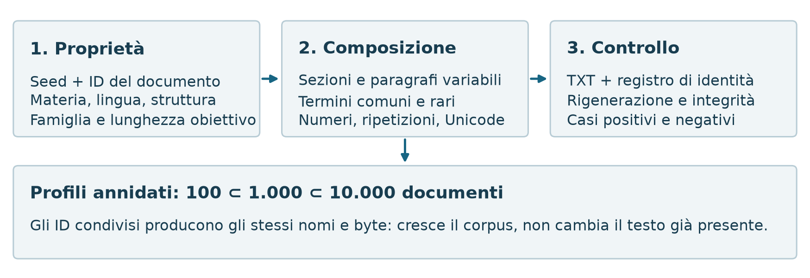
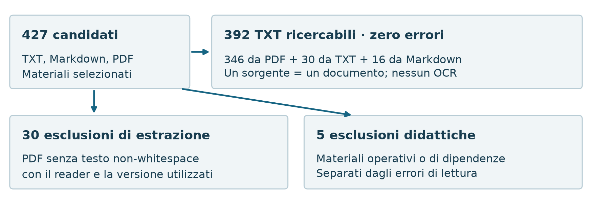
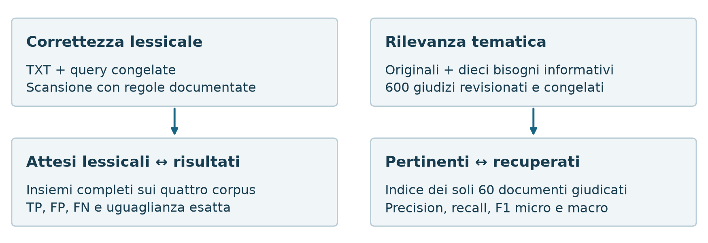
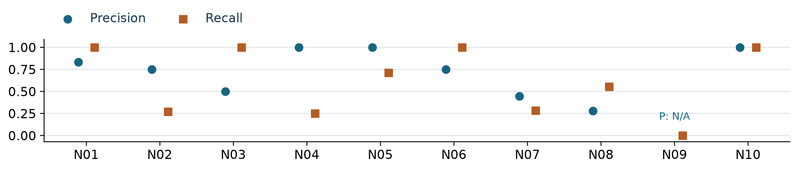
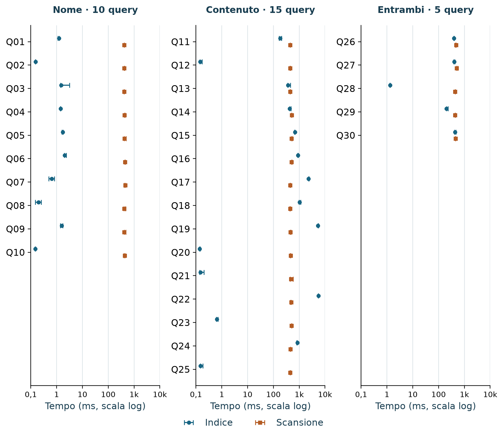
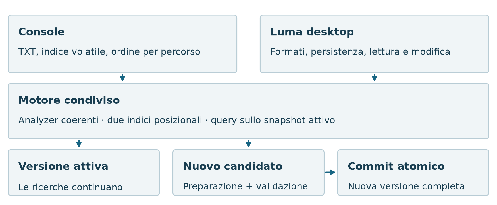

# 1. Cercare per nome e per contenuto

Un documento può essere riconosciuto dal nome oppure dalle parole che contiene. `MachineLearning.txt`, per esempio, può parlare di modelli statistici senza ripetere le parole del titolo. Local Document Search indicizza separatamente queste due rappresentazioni e rende esplicita la condizione che un risultato deve soddisfare.

Il nucleo richiesto dall'Homework 3 indicizza i TXT di una directory e delle sue sottocartelle, riceve query dalla console e restituisce i documenti corrispondenti. Il progetto è disponibile nel [repository GitHub Local Document Search](https://github.com/Forest904/local-document-search). Luma è l'applicazione desktop costruita sullo stesso motore: aggiunge formati, persistenza e strumenti di lettura, mantenendo autonoma la verifica della console.

La valutazione affronta tre domande: il motore rispetta la semantica dichiarata? Le query recuperano documenti pertinenti a un bisogno informativo? Quali tempi si osservano rispetto a una scansione sequenziale? Queste domande richiedono riferimenti e misure distinti.

## Gli analyzer: rendere confrontabili testo e query

Un *analyzer* trasforma il testo in token con posizione. Documento e query seguono regole coerenti: normalizzazione Unicode NFC, confronto senza distinzione fra maiuscole tramite *casefold* e nuova normalizzazione NFC. Punteggiatura, apostrofi e underscore separano i token; gli accenti restano significativi.

Nel nome si rimuove il suffisso finale supportato e si separano confini CamelCase e passaggi fra lettere e cifre. Nel contenuto queste separazioni aggiuntive non avvengono. La tabella mostra perché la distinzione è utile.

| Campo e stringa                   | Token                                       | Motivazione                                |
| :-------------------------------- | :------------------------------------------ | :----------------------------------------- |
| Nome `RomaTre.txt`              | `roma`, `tre`                           | Recuperare componenti concatenate          |
| Contenuto `RomaTre`             | `romatre`                                 | Conservare la parola del testo             |
| Nome `Unicode2026.TXT`          | `unicode`, `2026`                       | Ignorare l'estensione, mantenere il numero |
| Contenuto `L'acqua e il caffè` | `l`, `acqua`, `e`, `il`, `caffè` | Separare l'apostrofo, preservare l'accento |

Table: Esempi degli analyzer. Le posizioni sono assegnate nella sequenza risultante.

Non si applicano stemming o rimozione delle stop word: si evita una dipendenza dalla lingua e si conservano articoli e preposizioni nelle frasi. Il compromesso è intenzionale: `modello` e `modelli`, oppure `caffè` e `caffe`, restano termini diversi. Questa scelta contribuisce a spiegare i limiti della recall tematica discussi più avanti.

\newpage

# 2. Dalle parole agli indici posizionali

Un indice invertito associa un termine ai documenti nei quali compare. Qui le liste delle occorrenze, o *posting list*, conservano anche le posizioni: **termine → documento → posizioni**. Esistono due indici, uno per il nome e uno per il contenuto; le directory distinguono i documenti ma non fanno parte del campo nome. Le strutture sono implementate internamente, senza motori IR esterni.

{width=100%}

## Presenza, adiacenza e campo

La query `contenuto machine learning` richiede entrambe le parole: si intersecano gli insiemi di documenti associati ai termini. L'ordine nella query non cambia il risultato. La query `contenuto "machine learning"` richiede anche posizioni consecutive e, nell'esempio della figura, non trova il documento. `"deep learning"` lo trova; `"data data"` richiede due occorrenze consecutive, non una sola presenza di `data`.

La modalità `entrambi` unisce i documenti che soddisfano **l'intera query nel nome oppure l'intera query nel contenuto**. Un file `machine.txt` contenente `deep learning` non soddisfa `entrambi machine "deep learning"`: nessuno dei due campi contiene tutte le clausole. Concatenare nome e testo introdurrebbe invece una corrispondenza non prevista.

La console accetta i selettori `nome`, `contenuto` ed `entrambi`; senza selettore usa entrambi i campi. Restituisce percorsi relativi ordinati lessicograficamente, senza ranking. Termini e frasi possono comparire nella stessa query e sono combinati in AND.

## Il costo iniziale e le ricerche successive

L'indicizzazione comprende scoperta dei file, lettura, analisi e costruzione delle strutture. Le posizioni consentono poi di verificare le frasi senza rileggere i sorgenti a ogni interrogazione. Il costo di una ricerca dipende tuttavia anche dalla lunghezza dei posting, dal numero di risultati e dal lavoro necessario a presentarli: usare un indice non garantisce che ogni percorso applicativo sia più veloce di una scansione. La valutazione prestazionale misura proprio questa distinzione.

\newpage

# 3. Come sono stati generati i dati sintetici

Un piccolo corpus scritto a mano rende controllabili i casi limite, ma non mette alla prova il motore su molti documenti. Per questo sono stati generati tre corpus originali di 100, 1.000 e 10.000 TXT. Non provengono da documenti scaricati né dalla copia ripetuta di un unico testo: sono composizioni parametrizzate di frasi, con variabilità controllata.

La generazione è deterministica, con seed **20261113**. L'identificatore di ogni documento determina materia, lingua, struttura, famiglia di prova e lunghezza obiettivo; un generatore pseudocasuale locale, inizializzato da versione, seed e identificatore, sceglie l'ordine delle sezioni e le varianti dei paragrafi. La dimensione del profilo non partecipa alla generazione del singolo documento.

{width=100%}

Le sei materie sono analisi, reti, basi di dati, fisica, storia e linguistica. Ciascuna compare in italiano e inglese già nei primi cento documenti. Le quattro forme sono appunti, schede di laboratorio, esercitazioni e riepiloghi. Si mescolano da tre a sei titoli di sezione; ogni quattro paragrafi inizia una sezione. Cinque schemi di frase alternano osservazioni, esempi, procedure, domande e riepiloghi, con numeri variabili ed elenchi in alcune strutture.

Ogni materia ha un lessico di quattro termini e un principio descrittivo. I primi tre termini sono selezionabili in tutti i paragrafi; ogni diciassettesimo paragrafo può usare anche il quarto, più raro. Alcune frasi ripetono intenzionalmente una parola. Questa costruzione controlla frequenze e ripetizioni senza pretendere di simulare una distribuzione linguistica naturale.

Gli obiettivi per blocco di dieci file sono **6, 12, 18, 24, 30, 30, 36, 42, 48 e 54 kB** decimali. Si aggiungono paragrafi fino a superare l'obiettivo, sempre con una frase completa; si contano byte UTF-8, non caratteri. Nomi e percorsi comprendono materia, lingua e identificatore, con spazi e Unicode. Il nome completo non viene copiato nel testo. I caratteri accentati e le forme `Café`, `città`, `naïve` verificano anche la gestione Unicode.

\newpage

# 4. Dai materiali universitari ai file TXT

Il corpus reale deriva da una raccolta personale di materiali universitari. L'inventario seleziona TXT, Markdown e PDF, scartando directory tecniche come ambienti virtuali, dipendenze e build; non attraversa collegamenti simbolici o junction. I 427 candidati descrivono questa selezione, non tutti i file presenti nell'archivio personale.

Si lavora su copie locali ordinarie, senza modificare gli originali. Una revisione didattica esclude cinque documenti operativi o di dipendenze, mentre mantiene tre documenti introduttivi con spiegazioni utili al corso. Il percorso di preparazione è riassunto nella figura.

{width=100%}

## La conversione, formato per formato

I TXT sono decodificati in UTF-8 rigoroso, rimuovendo l'eventuale BOM iniziale. Un file vuoto resta valido e ricercabile per nome; una codifica non valida costituisce invece un errore. L'output della preparazione è testo UTF-8.

I Markdown vengono analizzati con **markdown-it-py 4.2.0**, usando CommonMark e supporto alle tabelle. Il reader conserva testo, codice inline ed etichette testuali, separa i blocchi e rimuove l'eventuale front matter. Non rende il documento come una pagina web: markup HTML, blocchi di codice e contenuti delle immagini non diventano automaticamente testo ricercabile. Non scarica risorse esterne.

Per i PDF si usa **pypdf 7.0.0**: il testo è estratto pagina per pagina e concatenato con separatori di riga. Ogni PDF con testo non-whitespace è ammesso, anche se contiene poche parole e molte immagini. Un PDF senza testo estraibile con questo reader viene escluso; non è per questo necessariamente vuoto o sicuramente scansionato. Password necessarie, corruzioni e letture fallite sono errori distinti. Non è previsto OCR.

**Un sorgente corrisponde a un TXT**, senza suddivisione per pagina. Nomi base e percorsi relativi sono conservati sotto gruppi separati per formato, evitando collisioni. La ricerca valutata opera sui TXT così ottenuti: può essere corretta rispetto all'estrazione anche quando il testo non rappresenta tutta l'informazione visibile nell'originale.

\newpage

# 5. Controllare i dati prima di valutare la ricerca

I corpus hanno ruoli complementari. Quello reale introduce linguaggio e formati autentici; quelli sintetici permettono di ripetere casi controllati a dimensioni crescenti. La tabella riporta i file effettivamente disponibili alla ricerca e il volume del testo, non la dimensione dei PDF originali.

| Corpus            |    TXT |  Byte UTF-8 | Composizione                     |
| :---------------- | -----: | ----------: | :------------------------------- |
| Sintetico piccolo |    100 |   3.008.718 | 52 IT / 48 EN                    |
| Sintetico medio   |  1.000 |  30.082.141 | 502 IT / 498 EN                  |
| Sintetico grande  | 10.000 | 300.840.184 | 5.002 IT / 4.998 EN              |
| Universitario     |    392 |  12.979.279 | 346 PDF, 30 TXT, 16 MD originali |

Table: Corpus finali. IT/EN indica la lingua assegnata dal generatore; non è una classificazione automatica dei documenti reali.

Nei sintetici le lunghezze minime/mediane/massime sono rispettivamente 6.034/30.103/54.215 byte, 6.001/30.080/54.215 e 6.000/30.083/54.228. Ogni struttura ha 25, 250 o 2.500 documenti; ogni famiglia di prova ne ha 10, 100 o 1.000. Le materie sono quasi uniformi, ma queste proprietà non rendono indipendenti tutte le combinazioni: la costruzione segue cicli deterministici.

## Negativi difficili, non soltanto esempi facili

Dieci famiglie riservano termini che non compaiono casualmente nei paragrafi: uno soltanto nel nome, uno soltanto nel contenuto, una coppia nello stesso nome o nello stesso contenuto, la coppia separata fra campi nelle due direzioni, una frase consecutiva, interrotta o invertita e due termini in sezioni distanti. Tre ulteriori termini sono assenti da tutti i documenti.

Per esempio, `frandilo spolvero` deve soddisfare la frase omonima, mentre `frandilo passaggio spolvero` e `spolvero frandilo` non devono soddisfarla. Un documento con `velnaro` nel nome e `tespilo` nel contenuto non soddisfa l'AND fra i due in modalità entrambi. Sono casi sintetici intenzionali: rendono riconoscibili errori che un testo generico potrebbe non rivelare.

## Integrità, duplicati e qualità dell'estrazione

Un registro collega originali e TXT e conserva dimensioni, identificatori di contenuto e versioni degli estrattori. I controlli rilevano file mancanti o aggiuntivi e alterazioni; sui sintetici rigenerano i documenti e verificano l'identità dei file condivisi fra profili. Nel corpus finale 36 documenti appartengono a 18 coppie di duplicati identici, sia come sorgenti sia come TXT. Restano documenti distinti: possono pesare più volte nelle metriche, che non sono misure su contenuti deduplicati.

La revisione visuale ha coperto **376 PDF**, osservando **1.105 delle 14.141 pagine**: tutte fino a tre pagine, altrimenti prima, centrale e ultima. Formule, tabelle, immagini e pagine non viste restano possibili fonti di perdita informativa. Il corpus personale non è distribuibile: la riproducibilità esterna riguarda il metodo e i sintetici, non l'accesso agli originali.

\newpage

# 6. Due riferimenti per due domande diverse

La *ground truth* è il riferimento contro cui si valuta un risultato. Qui occorrono due riferimenti: un documento può soddisfare esattamente una query senza essere pertinente al bisogno che l'ha motivata. La figura separa queste due nozioni.

{width=100%}

## Correttezza lessicale: una scansione indipendente

Un verificatore separato applica le regole documentate senza importare parser, analyzer o evaluator del prodotto. Legge i documenti, costruisce temporaneamente i token e controlla termini, frasi e vincoli fra campi senza indice invertito. L'indipendenza riduce il rischio di replicare un errore del codice, pur non eliminando un possibile errore comune nell'interpretazione delle specifiche.

Per ogni corpus si usano trenta query: dieci sul nome, quindici sul contenuto e cinque su entrambi. Comprendono termini, AND, frasi, assenze, ripetizioni, Unicode e selettività differenti. I tre sintetici condividono le query, con attesi specifici per scala; il reale usa un set distinto. Query e attesi sono congelati prima dell'esecuzione del motore. Gli attesi sono calcolati dalla scansione, con esempi controllati manualmente: non sono tutti annotati a mano.

Si confrontano gli insiemi completi di documenti, recuperando tutte le pagine dei risultati e controllando totali, ordinamento e duplicazioni. Un conteggio uguale con documenti diversi non costituisce un successo.

## Metriche sugli insiemi

I veri positivi (TP) sono recuperati e attesi; i falsi positivi (FP) sono recuperati ma non attesi; i falsi negativi (FN) sono attesi ma mancanti:

$$
P=\frac{TP}{TP+FP},\qquad R=\frac{TP}{TP+FN},\qquad F_1=\frac{2TP}{2TP+FP+FN}.
$$

Con attesi {A, B, C} e recuperati {B, C, D}, TP=2, FP=1 e FN=1: precision, recall e F1 valgono 2/3. Se un denominatore è nullo la metrica è N/A, non uno. Due insiemi vuoti possono essere esattamente uguali pur avendo tutte le metriche indefinite.

Le micro-metriche sommano prima TP, FP e FN; le macro-medie danno uguale peso alle query con valore definito e ne dichiarano il numero. La percentuale di insiemi esatti misura invece quante query non presentano alcuna differenza.

\newpage

# 7. Ground truth tematica: rendere osservabili i mancati recuperi

Per misurare la recall non basta leggere i risultati restituiti: occorre conoscere anche i documenti pertinenti che non compaiono. È stato quindi preparato un campione di **60 documenti**, interamente giudicato rispetto a **10 bisogni informativi**. La valutazione tematica usa un indice contenente soltanto questi sessanta TXT.

## Selezione del campione

Le quote sono 40 PDF, 10 TXT e 10 Markdown, riferite ai formati originali. I formati minoritari sono sovrarappresentati rispetto ai 392 documenti: il campione non è proporzionale e non autorizza inferenze statistiche sull'intero archivio.

La materia è attribuita usando il corso di provenienza con riscontro testuale. Per ciascun formato si ordinano i documenti per lunghezza del TXT e percorso e si dividono in terzili. I posti vengono assegnati ciclicamente agli strati non vuoti materia/terzile in ordine lessicografico. Dentro ogni strato si usa un ordinamento deterministico ottenuto dall'impronta di seed 20261113 e percorso, con spareggio per percorso. La selezione è quindi ripetibile; non è un campionamento casuale semplice. I duplicati non sono rimossi e la loro molteplicità è registrata.

## Dai bisogni ai 600 giudizi

Prima della ricerca, l'autore approva dieci bisogni, ciascuno con un criterio binario di rilevanza, esempi di inclusione/esclusione e una query iniziale. Ogni coppia documento–bisogno riceve poi un giudizio: **60 × 10 = 600**. La pertinenza non è dedotta dalla semplice presenza dei termini della query.

Le proposte sono preparate con assistenza dell'agente, consultando originali e passaggi pertinenti, quindi revisionate e approvate dall'autore senza mostrare i risultati del motore. Diciannove interpretazioni di confine sono risolte prima del congelamento finale. Non si tratta di annotazioni indipendenti di più valutatori e non è stata misurata concordanza inter-annotatore. Le query rimangono fisse dopo la valutazione.

La consultazione visuale dei 40 PDF ha interessato **117 pagine su 1.787**, scegliendo prima pagina, pagina pertinente e ultima quando distinte. I venti TXT/Markdown sono stati consultati nel sorgente e nelle sezioni pertinenti. Un Markdown rimandava soltanto a un'immagine non disponibile: la non pertinenza ai dieci bisogni è stata risolta dalla conferma dell'autore, senza osservazione dell'immagine da parte dell'agente.

## Cosa significa la recall ottenuta

Tutte le coppie hanno un'etichetta: questo consente di contare i rilevanti recuperati e quelli mancati nel campione. La completezza delle etichette non equivale però a una lettura integrale delle pagine. Un contenuto pertinente non osservato potrebbe produrre un giudizio negativo errato e modificare precision e recall.

I risultati dipendono dunque da selezione, bisogni, query e qualità dei giudizi. La recall riportata **non misura la copertura dell'intera raccolta universitaria**, né la quantità di informazione persa nell'estrazione. Testi, query reali e giudizi dettagliati restano locali; nella relazione si usano identificatori anonimi.

\newpage

# 8. Risultati della verifica lessicale

La prova didattica usa otto TXT, complessivamente 192 byte. Per rendere leggibili gli attesi: A contiene «Roma Tre studia machine deep learning. data data.»; B «Roma antica ospita tre scuole. machine learning.»; C «modelli statistici»; D «deep learning»; E «data mining data»; F «deep learning machine»; G è vuoto; H contiene «L'acqua e il caffè.».

I nomi sono, rispettivamente, `RomaTre.txt`, `sub/RomaNote.txt`, `MachineLearning.txt`, `machine.txt`, `DataNotes.txt`, `sub/DeepLearning.txt`, `Empty.txt`, `Unicode2026.TXT`. Gli ID nella tabella seguono l'ordine dei percorsi restituiti.

|  # | Query console                  | Attesi     | Ottenuti   |
| -: | :----------------------------- | :--------- | :--------- |
|  1 | `nome roma`                  | A, B       | A, B       |
|  2 | `contenuto inesistente`      | nessuno    | nessuno    |
|  3 | `contenuto machine learning` | A, F, B    | A, F, B    |
|  4 | `contenuto learning machine` | A, F, B    | A, F, B    |
|  5 | `contenuto "deep learning"`  | A, D, F    | A, D, F    |
|  6 | `contenuto "roma tre"`       | A          | A          |
|  7 | `nome "roma tre"`            | A          | A          |
|  8 | `contenuto ROMA`             | A, B       | A, B       |
|  9 | `contenuto "data data"`      | A          | A          |
| 10 | `contenuto learning`         | A, D, F, B | A, D, F, B |

Table: Dieci query della console, tutte corrette. Gli attesi derivano dalla lettura dei testi sintetici.

Anche `entrambi machine "deep learning"` e la stessa query senza selettore restituiscono A e F, escludendo D: verificano il vincolo dell'intera query in un solo campo. Il controllo avvia la console in un processo separato e confronta risultati, ordine e totali.

Sui corpus ampliati il confronto con la scansione indipendente produce:

| Corpus            | Insiemi esatti |     TP | FP | FN | Query valide P/R/F1 |
| :---------------- | -------------: | -----: | -: | -: | ------------------: |
| Sintetico 100     |          30/30 |    455 |  0 |  0 |               22/30 |
| Sintetico 1.000   |          30/30 |  4.535 |  0 |  0 |               22/30 |
| Sintetico 10.000  |          30/30 | 45.335 |  0 |  0 |               22/30 |
| Universitario 392 |          30/30 |    232 |  0 |  0 |               25/30 |

Table: Confronti lessicali completi. TP somma coppie query–documento, non documenti distinti del corpus.

Sono corretti **120 confronti su 120**, non 120 query testualmente diverse. Precision, recall e F1 micro e macro valgono 1 per ogni corpus; le query senza attesi hanno zero falsi positivi e metriche N/A. Questo dimostra conformità al riferimento sui casi provati, non pertinenza perfetta o assenza di ogni possibile difetto. Non verifica inoltre che il TXT conservi tutte le informazioni del PDF originale.

\newpage

# 9. Risultati tematici e interpretazione

Il confronto con i giudizi tematici produce risultati meno uniformi della verifica lessicale. La tabella conserva tutti i bisogni, compreso quello per cui la query non recupera alcun documento.

| Bisogno         |           TP |           FP |           FN |        Precision |           Recall |               F1 |
| :-------------- | -----------: | -----------: | -----------: | ---------------: | ---------------: | ---------------: |
| N01             |            5 |            1 |            0 |           0,8333 |           1,0000 |           0,9091 |
| N02             |            3 |            1 |            8 |           0,7500 |           0,2727 |           0,4000 |
| N03             |            1 |            1 |            0 |           0,5000 |           1,0000 |           0,6667 |
| N04             |            2 |            0 |            6 |           1,0000 |           0,2500 |           0,4000 |
| N05             |            5 |            0 |            2 |           1,0000 |           0,7143 |           0,8333 |
| N06             |            3 |            1 |            0 |           0,7500 |           1,0000 |           0,8571 |
| N07             |            4 |            5 |           10 |           0,4444 |           0,2857 |           0,3478 |
| N08             |            5 |           13 |            4 |           0,2778 |           0,5556 |           0,3704 |
| N09             |            0 |            0 |            1 |              N/A |           0,0000 |           0,0000 |
| N10             |            2 |            0 |            0 |           1,0000 |           1,0000 |           1,0000 |
| **Micro** | **30** | **22** | **31** | **0,5769** | **0,4918** | **0,5310** |
| **Macro** |           — |           — |           — | **0,7284** | **0,6078** | **0,5784** |

Table: Rilevanza sui soli 60 documenti giudicati. Valori macro validi: precision 9/10, recall 10/10, F1 10/10. Un solo insieme su dieci è esatto.

{width=92%}

I 30 TP e i 31 FN danno una recall micro di circa il 49% delle **61 coppie pertinenti**, non di 61 documenti distinti. La macro-recall è maggiore perché attribuisce uguale peso ai bisogni, mentre la micro pesa maggiormente quelli con più documenti pertinenti. N04 mostra che precision perfetta non implica buona recall; N08 evidenzia il costo di molti falsi positivi.

Le 53 diagnosi di FP/FN individuano menzioni in programmi o elenchi, trattazioni insufficienti e termini ambigui fra i falsi positivi; query troppo strette, singolare/plurale, sinonimi, abbreviazioni e differenze IT/EN fra i mancati recuperi. Come esempio soltanto illustrativo, cercare `transazione` può mancare un testo che usa solo `transazioni`. La scansione riproduce tutti i risultati lessicali delle dieci query: non emerge una divergenza del motore. Nessuno dei 53 casi dimostra da solo un difetto di estrazione; resta distinto il limite delle pagine e informazioni visuali non osservate.

\newpage

# 10. Prestazioni: che cosa è stato misurato

L'indice evita di analizzare ogni documento a ogni ricerca, ma richiede una costruzione iniziale e può svolgere lavoro aggiuntivo sui risultati. Per osservare questo compromesso è stato eseguito un pilot sui **100 TXT sintetici, circa 3 MB**, con le trenta query e gli attesi già congelati. Non sono state effettuate ottimizzazioni dopo aver osservato i tempi.

## Protocollo e condizioni

L'ambiente è Windows 11, Python 3.12.2, processore AMD Ryzen AI 7 350 e circa 33,6 GB decimali di RAM fisica rilevata.

Un processo costruisce l'indice volatile, esegue un passaggio di warm-up e tre passaggi misurati. Le query seguono l'ordine deterministico congelato; l'ordine dei metodi si alterna fra passaggi. La cache del sistema operativo non viene svuotata: letture di integrità, build e warm-up possono riscaldarla. Non si tratta di misure a cache fredda.

Il timer monotono ad alta risoluzione misura separatamente build e recupero completo dei risultati. La build comprende discovery, lettura, analisi, costruzione, validazione e attivazione in memoria; esclude avvio del processo, composizione dei servizi e preparazione/conversione del corpus. La build osservata è **1,910427 secondi**, con 100 file indicizzati e nessuna esclusione.

Il backend recupera tutte le pagine da 50 risultati, in ordine di percorso, includendo snippet e controlli di paginazione. La baseline enumera, apre e analizza tutti i TXT a ogni query, senza indice o cache applicativa; analizza entrambi i campi anche quando se ne interroga uno solo. Il confronto riguarda quindi **due percorsi completi con lavoro diverso**, non il solo accesso ai posting.

La verifica degli insiemi avviene fuori dai tratti cronometrati. Sono corretti 240 confronti su 240: 60 nel warm-up e 180 misurati, cioè 90 per metodo. Il run termina in 138,389 secondi, senza errori, timeout o casi mancanti; questa durata operativa non è la latenza di una query.

## Lettura delle statistiche

| Campo     | Campioni per metodo | Indice ms, mediana [min–max] | Scansione ms, mediana [min–max] |
| :-------- | ------------------: | :---------------------------- | :------------------------------- |
| Nome      |                  30 | 1,333 [0,146–3,145]          | 420,542 [401,308–490,992]       |
| Contenuto |                  45 | 454,039 [0,136–5.575,428]    | 456,790 [429,950–577,041]       |
| Entrambi  |                  15 | 389,425 [1,301–467,863]      | 445,700 [432,113–549,218]       |

Table: Statistiche sull'insieme dei campioni del campo. Gli intervalli mescolano query differenti e non sono intervalli di confidenza.

La mediana dei rapporti scansione/indice per query è 319,419 sul nome, 1,185 sul contenuto e 1,228 su entrambi. Non coincide necessariamente con il rapporto fra le mediane aggregate della tabella. I dettagli della figura successiva impediscono che un unico valore nasconda i casi sfavorevoli.

\newpage

# 11. Variabilità fra query e limiti del pilot

{width=100%}

Le query sul nome beneficiano nettamente dell'indice in questo pilot. Nel contenuto, invece, tempi molto brevi convivono con query che richiedono diversi secondi. Il minimo rapporto scansione/indice è **0,085**: per quel caso la scansione è più veloce. Non è stata accertata la causa specifica del rallentamento; numero di risultati e lavoro aggiuntivo sono fattori da investigare, non una diagnosi dimostrata.

\newpage

# 12. Luma: lo stesso motore in un'applicazione persistente

La console rende osservabile la semantica della ricerca; un'applicazione quotidiana deve anche conservare il lavoro, aggiornare i documenti e restare utilizzabile durante queste operazioni. Luma realizza questo passaggio mantenendo gli stessi indici e casi d'uso fondamentali. Non richiede servizi remoti: elaborazione e dati restano locali.

{width=100%}

La logica di analisi e ricerca è separata da filesystem, persistenza e interfaccia. La console usa un indice volatile e non richiede Qt; il desktop usa Qt Quick e salva in SQLite testo e posting. SQLite conserva le strutture, ma non esegue il retrieval full-text. Questa separazione permette di verificare la ricerca senza dipendere dalla GUI.

## Un aggiornamento concreto

Dopo una prima indicizzazione, un documento può cambiare, uno essere aggiunto e uno eliminato. La sincronizzazione confronta percorso, dimensione e timestamp di modifica, rilegge aggiunti e modificati, rimuove gli eliminati e riusa gli invariati. Se non ci sono differenze non produce una nuova versione.

Uno *snapshot* è una versione immutabile e coerente di documenti, testo e indici. Un solo writer prepara il candidato mentre le ricerche della stessa directory continuano a usare lo snapshot precedente. Dopo la validazione, un commit atomico rende disponibile la nuova versione completa. Un errore o un annullamento prima del commit non pubblica risultati parziali; il commit già iniziato non è interrompibile.

Il limite del confronto per metadati è esplicito: una modifica che conserva dimensione e timestamp può non essere rilevata. Non si aggiungono letture o hash dei sorgenti durante le query. I risultati descrivono la versione indicizzata e possono diventare obsoleti fino alla successiva sincronizzazione. Le risposte asincrone sono associate alla richiesta e allo snapshot, per evitare che una ricerca precedente sostituisca risultati più recenti.

\newpage

# 13. Ricerca avanzata, senza cambiare quella esatta

Nel desktop l'utente può estendere una parola con un asterisco: `documen*` cerca prefissi, `*zione` suffissi. Senza asterisco resta una ricerca esatta. Un vocabolario ordinato per campo permette di individuare l'intervallo dei prefissi tramite ricerca binaria; un vocabolario di termini rovesciati trasforma i suffissi in prefissi, senza duplicare i posting.

Le espansioni richiedono almeno due caratteri normalizzati e sono ammesse fuori dalle frasi. Sono limitate a 256 termini per clausola e campo: superare il limite produce una segnalazione di query troppo ampia, non risultati troncati silenziosamente. La scelta mantiene esplicita la differenza fra ricerca esatta ed espansione.

## Suggerimenti e correzione proposta

Durante la digitazione vengono suggeriti termini presenti nel vocabolario; scegliere un suggerimento completa il termine e avvia la ricerca. Digitare, da solo, non esegue la query.

Dopo una ricerca di parole esatte può comparire una proposta ortografica. I candidati vengono confrontati mediante bigrammi, indice di Jaccard e distanza di Levenshtein, che conta inserimenti, cancellazioni e sostituzioni. La proposta richiede una scelta dell'utente: non modifica silenziosamente la query, le frasi o il comportamento della console. È una funzione distinta dalla ricerca semantica, che non è implementata.

## Dalla corrispondenza alla lettura

L'ordinamento desktop considera soltanto i documenti che soddisfano tutta la query: privilegia le corrispondenze nel nome e poi le posizioni distinte corrispondenti, con spareggio stabile per percorso. Non è un modello di rilevanza appreso e non è il ranking valutato dalle metriche della console.

Filtri di formato, snippet ed evidenziazione aiutano a interpretare i risultati. Gli estratti usano il testo dello snapshot, senza rileggere il sorgente durante la ricerca. I token `.txt`, `.md` e `.pdf` nella barra possono selezionare i formati; filtri e ordinamento precedono la paginazione, mantenendo coerenti totali e pagine.

I PDF si aprono nel viewer interno alla pagina del primo match nel contenuto, grazie a una mappa delle pagine; se il match è soltanto nel nome, si apre la prima. Questo non equivale a localizzare graficamente la parola nella pagina. TXT e Markdown offrono lettura e ricerca manuale, oltre al salto al match quando il sorgente è coerente con la versione indicizzata; Markdown dispone anche di anteprima formattata offline.

La modifica di TXT e Markdown è esplicita. La bozza viene protetta, il salvataggio verifica conflitti e sostituisce atomicamente il file, poi richiede un aggiornamento dell'indice. Italiano e inglese, temi, scorciatoie e guida locale completano il flusso. Queste funzioni ampliano l'utilizzabilità del motore, ma non eliminano i limiti lessicali e di estrazione emersi nella valutazione.

\newpage

# 14. Dal risultato al documento

Il flusso principale consiste nello scegliere una cartella, attendere l'indicizzazione in background, inviare una query e aprire un risultato. Le due schermate mostrano lo stesso scenario su tre documenti sintetici, senza esporre dati universitari personali.

{width=80%}

Il risultato conserva il contesto necessario per decidere se aprire il documento. Lettura, ricerca manuale nel file e modifica restano azioni distinguibili: trovare una parola nel documento aperto non cambia la query sull'indice, mentre salvare una modifica richiede una sincronizzazione per renderla ricercabile. L'interfaccia rende quindi visibile il rapporto fra sorgente e rappresentazione indicizzata.

\newpage

# 15. Conclusioni: risultati, limiti e sviluppi

La principale evidenza è la distinzione fra correttezza e utilità del recupero. I **120 confronti lessicali esatti** mostrano accordo con un verificatore indipendente sui casi provati. I **600 giudizi tematici**, invece, evidenziano una recall micro di **0,4918** e una precision di **0,5769**: un motore può applicare correttamente le regole e mancare documenti pertinenti quando la formulazione della query non coincide con quella dei testi.

## Il valore dell'approccio adottato

Il punto di forza del progetto è la possibilità di spiegare e verificare ogni passaggio: dal testo ai token, dai token ai posting e dai risultati alle metriche. Gli indici posizionali rendono esplicita la semantica delle frasi; il backend condiviso porta la stessa logica dalla console a un'applicazione utilizzabile. Gli snapshot immutabili e l'attivazione atomica proteggono la coerenza delle ricerche durante gli aggiornamenti.

Anche il disegno sperimentale favorisce verifiche controllabili. I sintetici deterministici e annidati consentono confronti ripetibili; i materiali reali introducono varietà autentica. Il verificatore indipendente e i giudizi fissati prima dei risultati riducono il rischio di costruire una valutazione favorevole a posteriori. Distinguere correttezza, rilevanza e prestazioni permette di riconoscere con precisione sia i risultati raggiunti sia le priorità di miglioramento.

Le verifiche automatiche comprendono piccoli esempi calcolati manualmente per le metriche, casi Unicode e frasi, controlli di integrità e riproducibilità, paginazione completa e rifiuto di giudizi incompleti. La regressione console viene eseguita separatamente dalle funzioni desktop. Le prove automatiche non sostituiscono la revisione dei documenti o l'interpretazione dei risultati.

## I limiti che restano

Le metriche tematiche descrivono il campione e i bisogni scelti, con i limiti di revisione e campionamento illustrati nella sezione 7. La correttezza sui TXT non equivale alla copertura di tutte le informazioni visuali degli originali. La raccolta personale resta inoltre non distribuibile, mentre metodo e generazione sintetica sono riproducibili esternamente.

Il pilot evidenzia un netto vantaggio sul nome e risultati più variabili sul contenuto. Mancano misure ripetute sulle scale maggiori per concludere sulla scalabilità; i benchmark desktop, con protocolli e scopi diversi, restano separati.

Una prosecuzione utile misurerebbe build e ricerca su più scale e processi e amplierebbe la revisione indipendente dei giudizi. Stemming o espansioni linguistiche andrebbero valutati come nuovi esperimenti, confrontando benefici di recall e possibili perdite di precision; non sono miglioramenti già dimostrati. Luma mostra intanto come lo stesso motore possa sostenere un'applicazione locale con risultati spiegabili e aggiornamenti coerenti.

**Riferimenti.**  Codice, metodo e istruzioni: [github.com/Forest904/local-document-search](https://github.com/Forest904/local-document-search).
